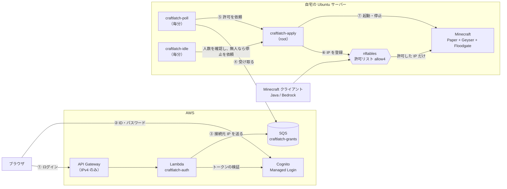

# CraftLatch

自宅で動かしている Minecraft サーバーへの接続を、Amazon Cognito でログインした人の IP アドレスだけに許可する仕組みです。ログインをきっかけにサーバーを自動で起動し、誰もいない状態が 15 分続くとワールドを保存して停止します。

- **ログインした IP アドレスだけを通す**: ログインに成功すると、その IPv4 アドレスを nftables の許可リストに 10 分の期限で登録します。通信があるたびに期限は 10 分に戻るため、遊んでいる間は切れません。切断から 10 分で消えます。
- **ログインのたびにパスワードを入力する**: Cognito のセッションでログインを省略させず、毎回 ID とパスワードの入力を求めます。
- **使うときだけサーバーを動かす**: 停止中にログインすると Minecraft サーバーを起動し、無人が 15 分続くと `stop` コマンドで正常に停止します。
- **Java 版と Bedrock 版の両方に対応**: Java 版は TCP/25565、Bedrock 版は Geyser 経由の UDP/19132 を同じ許可リストで制御します。
- **LAN と WireGuard は認証なし**: 家の中のネットワークと WireGuard からの接続は、ログインなしで許可します。

> [!NOTE]
> 許可は IP アドレス単位です。同じグローバル IP アドレスを共有する人（同じ Wi-Fi の利用者など）も接続できるため、Minecraft のホワイトリスト（Java 版は `online-mode`、Bedrock 版は Floodgate による認証と併用）で、遊べるアカウントを別に制限しています。また、通信先によって外向きの IP アドレスが変わる回線（一部のモバイル回線など）では接続できません。詳しくは [利用者ガイド](docs/user-guide.md) を参照してください。

## 仕組み



1. 利用者がブラウザでログインページを開き、Cognito で ID とパスワードを入力します。
2. Lambda がトークンを検証し、ログインした接続元の IPv4 アドレスを SQS に送ります。
3. サーバー側の `craftlatch-poll` が毎分 SQS を確認し、受け取った IP アドレスの許可を依頼します。
4. root で動く `craftlatch-apply` が依頼を再検証し、nftables に IP アドレスを登録して、止まっていれば Minecraft を起動します。
5. ログインしてから接続できるまで、通常 1 分ほどかかります（サーバーが止まっていた場合は、起動の時間が加わります）。

AWS からサーバーへ接続する経路はなく、サーバーが SQS を取りに行くだけです。各部品は権限を分けた別のユーザーで動き、失敗すると Discord に通知します。設計の詳細と、そう決めた理由は [設計書](docs/superpowers/specs/2026-11-01-craftlatch-design.md) にあります。

## ドキュメント

| 文書 | 読む人 | 内容 |
|---|---|---|
| [利用者ガイド](docs/user-guide.md) | プレイヤー | ログインから接続までの流れ、接続先、つながらないときの確認事項 |
| [初期構築手順](docs/setup.md) | 管理者 | AWS・GitHub・Ubuntu サーバーを最初から構築する手順 |
| [運用手順](docs/operations.md) | 管理者 | ユーザーの追加・削除、障害時の確認、キーのローテーション、設定の変更 |
| [設計書](docs/superpowers/specs/2026-11-01-craftlatch-design.md) | 開発者 | 全体構成、各部品の仕様、セキュリティ上の判断とその理由 |

## ディレクトリ構成

```text
infra/bootstrap/   GitHub OIDC・GitHub Actions 用 IAM ロール・Cognito User Pool（管理者が手元で実行）
infra/terraform/   API Gateway・Lambda・SQS・IAM など（GitHub Actions から実行）
src/lambda/        Lambda 関数 craftlatch-auth（ログインページとコールバック）
host/              Ubuntu サーバーに配置するもの
  lib/             poll・apply・idle・notify・fwcheck などの本体（Python）
  systemd/         各サービス・タイマー・パスのユニットファイル
  scripts/         アクセスキーのローテーション用スクリプト
  install.sh       ファイルの配置と権限の設定
tests/             Lambda と host/lib の単体テスト（pytest）
docs/              利用者ガイド・構築手順・運用手順・設計書
.github/workflows/ CI（テスト・shellcheck・terraform の検証）と Terraform の plan・apply
```

## 開発

[uv](https://docs.astral.sh/uv/) で Python 3.12 の環境を用意し、テストを実行します。

```bash
uv sync
uv run pytest
```

PR では GitHub Actions がテスト・shellcheck・`terraform fmt`・`terraform validate` を実行します。`infra/terraform/` か `src/lambda/` を変更した PR では plan も実行し、`main` へのマージ後に `production` 環境の承認を経て apply します。`infra/bootstrap/` は GitHub Actions からは実行せず、管理者が手元で apply します。

このリポジトリは公開されています。AWS のアカウント ID・メールアドレス・API や SQS の URL・Cognito のドメインなどは、コード・コミットメッセージ・PR に書かないでください。秘密情報はサーバーの `/etc/craftlatch/` にだけ置きます。

### 開発環境（DevContainer）

このリポジトリは Claude Code・Codex CLI 向けの DevContainer テンプレート（[Knu334/ClaudeCodeDevContainer](https://github.com/Knu334/ClaudeCodeDevContainer)）から作成しています。

1. `.devcontainer/.env.sample` を `.devcontainer/.env` にコピーし、`GH_TOKEN`・`GIT_USER_EMAIL`・`GIT_USER_NAME` を設定します（Context7 を使う場合は `CONTEXT7_API_KEY`、Codex CLI を使う場合は `OPENAI_API_KEY` も）。
2. VS Code の Dev Containers 拡張機能で「コンテナーで再度開く」を実行します。

コンテナは `.devcontainer/init-firewall.sh` で許可したドメイン以外へ通信できません。通信先を追加する場合は、このファイルの `# Resolve and add other allowed domains` の節に追記します。

テンプレートの更新を取り込むには、テンプレートをリモートに追加してマージします。

```bash
git remote add template https://github.com/Knu334/ClaudeCodeDevContainer.git
git fetch template
git merge template/main
```
