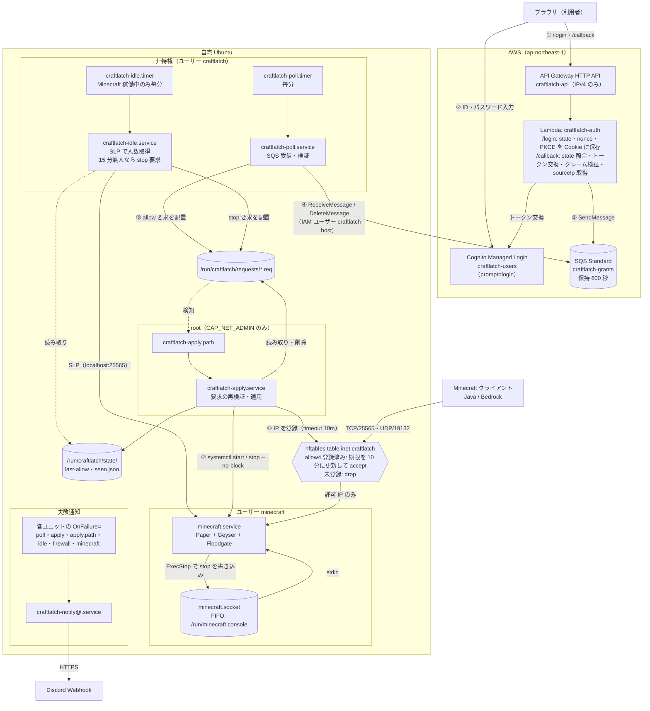
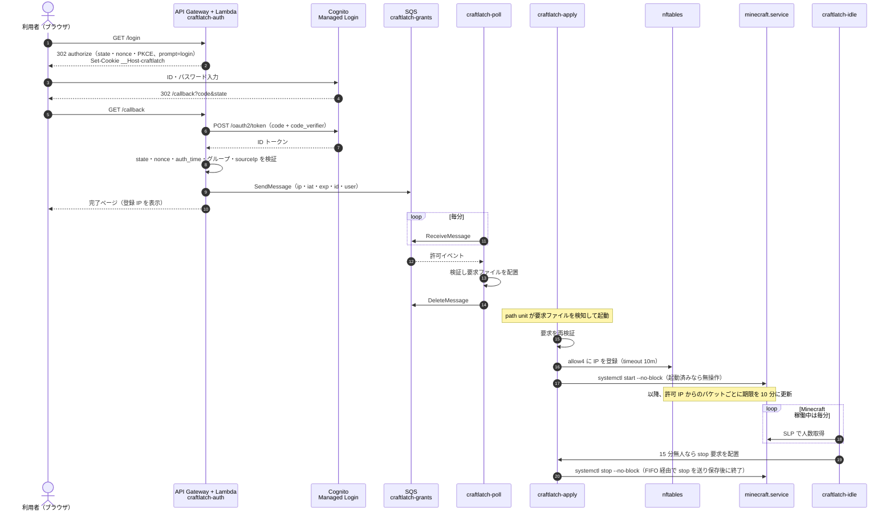

# CraftLatch 詳細設計書 — Minecraft サーバー Cognito 認証ゲート

- 作成日: 2026-11-01
- 対象リポジトリ: `Knu334-Inc/CraftLatch`
- ステータス: 設計レビュー待ち（実装コードの作成・AWS/Ubuntu 環境の変更は本書の範囲外）

---

## 1. 目的とスコープ

自宅 Ubuntu サーバーで稼働する Minecraft サーバー（Paper + Geyser + Floodgate）について、Amazon Cognito による認証に成功したグローバル IPv4 アドレスからのみ Java 版（TCP/25565）・Bedrock 版（UDP/19132）へ到達できるようにする。あわせて認証をトリガーにサーバーを自動起動し、無人状態が続いたら正常停止する。

重視する順序: セキュリティ ＞ AWS 利用料金 ＞ リソース消費 ＞ 運用負荷 ＞ 実装のシンプルさ。

### 1.1 確定した前提

| 項目 | 内容 |
|---|---|
| サーバー | Paper（Java Edition）+ Geyser-Spigot + Floodgate + DriveBackupV2 + Multiverse 系。`/media/ssd/paper/` 配下（`/etc/fstab` による常時マウント） |
| 公開ポート | ルーターで IPv4 の TCP/25565 と UDP/19132 をポートフォワード。グローバル IP は固定 |
| バックアップ | DriveBackupV2 で取得済み（本設計の範囲外。自動停止との関係は 7.4 の注意点を参照） |
| IPv6 | Ubuntu では無効（カーネル引数 `ipv6.disable=1`） |
| UFW | 無効（`nftables.service` も無効）。ホストのフィルタは本設計の nftables テーブルのみ。Docker が稼働しており独自の iptables（nft バックエンド）ルールを持つが、本設計の専用テーブルとは独立 |
| 既存起動方式 | `fuu62121`（sudo・docker グループ所属）で `screen` 経由で `paper-1.21.7-17.jar` を `-Xmx4G -Xms4G` で起動、`Restart=always`、enable 済み → 専用ユーザーへ移行する |
| サーバー | Ubuntu 24.04.5 LTS、カーネル 6.8、systemd 255、4 コア、メモリ 15 GiB（スワップなし）、OpenJDK 21、Python 3.12（boto3 未導入）、nftables 1.0.9、時刻同期済み |
| ネットワーク | LAN: `enp3s0`（`192.168.33.4/24`）、WireGuard: `wg0`（`10.0.0.1`、ピア `10.0.0.2`・`10.0.0.3`）。ルーターのポートフォワードは送信元を書き換えない（ログで確認済み） |
| 既存の RCON 利用 | `whiteman.jar`（root で常駐、RCON でホワイトリストを管理）。CraftLatch と役割が重なるため廃止予定 |
| TPM 2.0 | なし |
| AWS リージョン | ap-northeast-1（仮定） |
| 利用規模 | 数名、認証 1 日 5 回程度 |
| 実装言語 | Python（Lambda・Ubuntu とも） |
| IaC | Terraform（state は S3 バックエンド）。GitHub Actions から GitHub OIDC で実行（Lambda のコードのデプロイを含む） |
| リポジトリ | `Knu334-Inc/CraftLatch`（**公開リポジトリ**） |
| 障害通知 | Discord Webhook |

### 1.2 要件の解釈（合意済み）

- 「通信のたびに 10 分延長」により、**接続中は失効しない**。失効は実質「最後のパケットから 10 分後」（切断後 10 分）。プレイ中の強制再認証は行わない。
- 「失効後は再度 Cognito 認証が必要」は、**毎回 ID/パスワード入力を強制**する（`prompt=login` + `auth_time` 検証）。厳密な保証範囲は「直近 120 秒以内に入力があったこと」（4.3）。
- MFA は使用しない。
- LAN（`enp3s0` の `192.168.33.0/24`）と WireGuard（`wg0` の `10.0.0.0/24`）からの接続は信頼し、Cognito 認証なしで許可する（6.1）。認証による IP 制御の対象はインターネットからの接続のみ。

---

## 2. 現行構成案のレビュー結果

| # | 指摘 | 内容 | 対応 |
|---|---|---|---|
| P1 | ipset の単純マッチでは期限が延長されない | `-m set --match-set` は照合のみ。延長には `-j SET --add-set --exist` が別途必要。Ubuntu の iptables は nft バックエンドで ipset と二系統になる | nftables ネイティブ set の `update @set { ip saddr timeout 10m }` を採用 |
| P2 | 接続中は失効しない | Minecraft プロトコルの KeepAlive（約 15 秒）やゲームパケットで常時延長される。OS の TCP KeepAlive（既定無効/2 時間）は無関係 | 要件解釈として明記（1.2） |
| P3 | ESTABLISHED による迂回 | 一般的なルールセットは ESTABLISHED を先に許可する | 専用チェインで ct state に関係なく未許可送信元を drop |
| P4 | 認証 IP と接続 IP のファミリー不一致 | ブラウザは IPv6 を優先し、Java クライアントは IPv4 を優先しがち。Lambda Function URL はデュアルスタック | 入口は IPv4 のみの API Gateway HTTP API（既定 IPv4）を採用。Function URL は不採用 |
| P5 | 遅延した古い許可イベント | 数時間後に処理すると、その IP が既に他人のものである可能性 | メッセージに `exp` を持たせ、SQS 保持期間も 600 秒に短縮 |
| P6 | DLQ が実質無意味 | Standard キューでは DLQ 移動後も元の投入時刻で期限切れになる | DLQ なし。不正メッセージはログ出力後に削除 |
| P7 | SIGTERM での保存が保証されない | バニラ/派生サーバーで SIGTERM 時に保存されない報告あり（公式記述なし） | FIFO 経由で stdin に `stop` を送る `ExecStop` |
| P8 | sudo と `NoNewPrivileges` の両立不可 | 受信プロセスを堅牢化すると sudo が使えない | 要求ファイル + path unit + root の apply service に分離 |
| P9 | Cognito のセッションで再認証が素通りになる | Managed Login のセッションクッキーで入力なし成功 | `prompt=login` + Lambda 側で `auth_time` を検証 |
| P10 | 同一グローバル IP の共有者も到達できる | CGNAT・公衆 Wi-Fi・同居人 | ホワイトリスト + `online-mode` + Floodgate を本当のアカウント認可とする |
| P11 | 「プラグイン原則不使用」と実環境の相違 | 実際は Paper + Geyser + Floodgate。Bedrock は UDP/19132 で、Geyser は直接接続のため TCP 接続として見えない | UDP/19132 も同じ許可リストで制御。人数取得は SLP（Paper の `players.online` に Bedrock も含まれる） |
| P12 | 既存サーバーが sudoers ユーザーで稼働 | Paper/Geyser の RCE がホスト全体の侵害に直結 | 専用ユーザー `minecraft`（nologin、sudo 不可）へ移行 |
| P13 | ブラウザのプライバシー機能による IP ずれ | iCloud プライベートリレー・ブラウザの IP 保護・VPN 使用時は中継 IP が登録される | 利用者向け案内に記載し、完了ページに登録 IP を表示 |

### 2.1 技術選定の結果

| 領域 | 採用 | 退けた案と理由 |
|---|---|---|
| 認証 | Cognito User Pool（Essentials）+ Managed Login | Lite は Managed Login と `prompt` 非対応。Plus は無料枠なし |
| 入口 | API Gateway HTTP API（IPv4） | Lambda Function URL: デュアルスタックで P4 が発生。REST API: 高価で機能過剰。ALB: 月額固定費 |
| 処理 | Lambda（Python 3.13、arm64、標準ライブラリ + 同梱 boto3） | Java + SnapStart: 体感速度は人の入力・ポーリング待ち・MC 起動時間が支配的で効果がない。ビルドが重く、スナップショット復元時に乱数の一意性の落とし穴がある。TypeScript: Ubuntu 側に Node.js と npm 依存が増える |
| 受け渡し | SQS Standard（DLQ なし） | FIFO: 処理が冪等なので不要 |
| AWS 認証情報 | IAM ユーザーのアクセスキー（受信・削除のみ） | IAM Roles Anywhere: TPM がない環境では秘密鍵がファイルとなり、アクセスキーと比べて安全性の差が小さい一方、CA・トラストアンカー・プロファイル・署名ヘルパー・証明書更新の運用が増える |
| 特権分離 | 要求ファイル + path unit + root の apply service | sudo + ヘルパー: `NoNewPrivileges` 不可、setuid が攻撃面になる。capability + polkit: `CAP_NET_ADMIN` をネットワーク入力処理プロセスに与えることになる |
| ファイアウォール | nftables 専用テーブル | iptables + ipset: P1 |
| 人数取得 | localhost への Server List Ping | RCON: bind 先を絞れずパスワード管理が必要。`/proc/net/tcp`: Bedrock 版プレイヤーを数えられない |
| 停止 | systemd の FIFO ソケットで stdin に `stop` | SIGTERM のみ: P7 |
| 定期実行 | systemd timer + oneshot | 常駐の長時間ポーリング: 常駐プロセスが増える |
| 通知 | systemd `OnFailure=` → Discord Webhook | SNS: Ubuntu のキーに `sns:Publish` の権限が増える |

---

## 3. 全体構成



### 3.1 正常時のシーケンス



1. 利用者が `https://<api-id>.execute-api.ap-northeast-1.amazonaws.com/login` を開く。
2. Lambda が state・nonce・code_verifier を生成し、`__Host-craftlatch` Cookie に保存して Cognito の authorize エンドポイントへ 302 リダイレクトする（`prompt=login`、`code_challenge_method=S256`）。
3. 利用者がユーザー名とパスワードを入力し、`/callback?code=...&state=...` に戻る。
4. Lambda が state を照合し、トークン交換と ID トークンのクレーム検証を行い、`requestContext.http.sourceIp` を取得・検証して SQS に許可イベントを送信する。完了ページに登録 IP を表示する。
5. 通常 1 分程度で poll service がメッセージを受信・検証し（毎分の起動に処理時間・通信時間が加わるため厳密な上限ではない）、要求ファイルを置いてから SQS から削除する。
6. path unit が apply service を起動し、apply が要求を再検証して nft の set に IP を登録し、`minecraft.service` を起動する（起動済みなら何もしない）。
7. 以降、許可 IP からのパケットが届くたびに期限が 10 分延長される。最後のパケットから 10 分で自動失効する。
8. Minecraft 稼働中は idle service が毎分人数を取得し、15 分連続で 0 人なら stop 要求を置き、apply が正常停止させる。

### 3.2 命名規則

接頭辞 `craftlatch-`（GitHub リモート `Knu334-Inc/CraftLatch` に由来）。AWS タグは `Project=CraftLatch`。

| 対象 | 名前 |
|---|---|
| User Pool / アプリクライアント / グループ | `craftlatch-users` / `craftlatch-web` / `minecraft` |
| Cognito ドメイン | `craftlatch-<ランダム文字列>` |
| HTTP API / Lambda / Lambda ロール | `craftlatch-api` / `craftlatch-auth` / `craftlatch-auth-role` |
| SQS | `craftlatch-grants` |
| Ubuntu 用 IAM ユーザー | `craftlatch-host` |
| Terraform state バケット | `craftlatch-tfstate-<account_id>` |
| systemd ユニット | `craftlatch-firewall` / `craftlatch-poll` / `craftlatch-apply` / `craftlatch-idle` / `craftlatch-notify@` / `minecraft` |
| nftables | `table inet craftlatch`、set `allow4` |
| Linux ユーザー | `minecraft`（サーバー本体）、`craftlatch`（受信・無人検知） |

### 3.3 リポジトリ構成（実装時）

```
infra/bootstrap/          GitHub OIDC プロバイダー・GHA 用 IAM ロール・Permissions Boundary・User Pool（管理者が手元で 1 回だけ実行）
infra/terraform/          versions.tf backend.tf variables.tf cognito.tf api.tf lambda.tf sqs.tf iam.tf outputs.tf
src/lambda/craftlatch_auth/handler.py
host/lib/                 common.py poll.py apply.py idle.py notify.py fwcheck mc-stop
host/systemd/             *.service *.timer *.path *.socket
host/nftables/craftlatch.nft
host/tmpfiles.d/craftlatch.conf
host/scripts/craftlatch-rotate-key
host/install.sh           Ubuntu へのファイル配置・権限設定・daemon-reload
tests/                    Lambda と host/lib の単体テスト
.github/workflows/        ci.yml terraform-plan.yml terraform-apply.yml
docs/                     setup.md operations.md user-guide.md（第 12 章）
```

---

## 4. AWS 側の設計

### 4.1 Cognito User Pool `craftlatch-users`

User Pool 本体は `infra/bootstrap`（4.7）で管理者が作成・変更する。AWS アカウントは他のシステムと共有する前提で、GitHub Actions の apply ロールに User Pool の作成（とその依存アクションのタグ付け）を許すと、同じアカウントのタグのない User Pool に `Project=CraftLatch` を付けて管理下に入れられるためである。削除保護を有効にする。`infra/terraform` は名前 `craftlatch-users` で User Pool を参照し（`data "aws_cognito_user_pools"`）、ちょうど 1 件でなければ plan・apply を停止する。グループ・ドメイン・アプリクライアント・Managed Login ブランディングは `infra/terraform` で作成する。

| 項目 | 設定 | 理由 |
|---|---|---|
| プラン | Essentials | Managed Login と `prompt=login` に必要。10,000 MAU まで無料 |
| サインイン識別子 | ユーザー名 | メール属性は不要 |
| ユーザー名の大文字小文字 | 区別しない（`case_sensitive=false`。作成後は変更不可） | 大文字小文字だけが異なる同名ユーザーの作成を防ぐ |
| サインアップ | 管理者のみ（`AllowAdminCreateUserOnly=true`） | 第三者が自分でアカウントを作れないようにする |
| MFA | OFF | 合意事項 |
| パスワードポリシー | 最小 8 文字。英大文字・英小文字・数字・記号をそれぞれ 1 文字以上含む | 利用者の負担を考慮した管理者の判断（2026-11-01 に 14 文字から変更）。MFA がないため、推測されにくいパスワードを利用者に求める |
| アカウント復旧 | 管理者リセットのみ | メール送信の設定が不要。メールアカウント侵害で突破されない |
| 削除保護 | 有効（`deletion_protection = ACTIVE`） | 共有アカウントでの誤削除を防ぐ。削除は bootstrap の管理者が意図して外した場合のみ |
| ユーザー存在エラーの秘匿 | 有効 | ユーザー名の列挙を防ぐ |
| グループ | `minecraft` | 所属しないユーザーは認証に成功しても拒否 |
| ドメイン | Cognito プレフィックスドメイン | 無料。独自ドメインは使わない |
| Managed Login ブランディング | 既定スタイル（`aws_cognito_managed_login_branding`） | Managed Login の利用に必要 |

アプリクライアント `craftlatch-web`:

- パブリッククライアント（クライアントシークレットなし）+ PKCE。シークレットの保管が不要で、トークン取得には認可コードと code_verifier の両方が必要。
- 許可フロー: `code` のみ。スコープ: `openid` のみ。
- 認証フロー（`ExplicitAuthFlows`）: `ALLOW_REFRESH_TOKEN_AUTH` のみ（Managed Login の code フロー以外を無効化）。
- コールバック URL: `https://<api-id>.execute-api.ap-northeast-1.amazonaws.com/callback` の 1 件のみ。ログアウト URL なし。
- ID・アクセストークン有効期間: 5 分（最短）。リフレッシュトークン: 60 分（最短）。リフレッシュトークンは Lambda で使わずに破棄する。

ユーザー追加手順（管理者）:

```
aws cognito-idp admin-create-user --user-pool-id <POOL_ID> --username <NAME> --temporary-password '<TEMP_PASSWORD>' --message-action SUPPRESS
aws cognito-idp admin-add-user-to-group --user-pool-id <POOL_ID> --username <NAME> --group-name minecraft
```

一時パスワードは別の経路で本人に伝え、初回ログイン時に変更させる。ユーザー名は 5.3 の `user` の規則（`^[A-Za-z0-9._@+-]{1,128}$`）に合うものだけを作成する。Lambda も SQS に送る前に同じ規則で検証し、合わなければ送信せずエラーページ（「アカウント設定に問題があります。管理者に連絡してください」）を返してログに残す（Cognito では作成できるがホスト側で拒否される名前で、完了ページが出たのに許可されない事態を防ぐ）。

### 4.2 API Gateway HTTP API `craftlatch-api`

- IP アドレスタイプ: IPv4（既定）。**デュアルスタックにしてはならない**（P4）。
- ルート: `GET /login`、`GET /callback` のみ。`$default` ルートは作らない（他のパスは 404）。
- 統合: Lambda プロキシ統合、ペイロード形式 2.0。
- ステージ `$default`、自動デプロイ有効、スロットリング: burst 5、rate 1 リクエスト/秒。
- アクセスログ: 無効（Lambda のログで足りる）。

### 4.3 Lambda `craftlatch-auth`

| 項目 | 値 |
|---|---|
| ランタイム | Python 3.13、arm64 |
| メモリ / タイムアウト | 128 MB / 10 秒 |
| 依存 | 標準ライブラリ + ランタイム同梱の boto3 のみ（ZIP を `archive_file` で作成） |
| ログ | CloudWatch Logs、保持 30 日 |

環境変数:

| 名前 | 例 |
|---|---|
| `COGNITO_DOMAIN` | `craftlatch-xxxx.auth.ap-northeast-1.amazoncognito.com` |
| `CLIENT_ID` | アプリクライアント ID |
| `ISSUER` | `https://cognito-idp.ap-northeast-1.amazonaws.com/<POOL_ID>` |
| `REDIRECT_URI` | `https://<api-id>.execute-api.ap-northeast-1.amazonaws.com/callback` |
| `QUEUE_URL` | `craftlatch-grants` の URL |
| `ALLOWED_GROUP` | `minecraft` |
| `MAX_AUTH_AGE` | `120` |
| `GRANT_TTL` | `600` |

#### `/login`

1. `secrets.token_urlsafe(32)` で state・nonce・code_verifier を生成する。
2. Cookie `__Host-craftlatch` に `{"s":state,"n":nonce,"v":verifier,"t":発行時刻}` を base64url で格納する。属性: `HttpOnly; Secure; SameSite=Lax; Path=/; Max-Age=600`。
   - Cookie に署名は付けない。改ざんしても影響は本人の認証フローにとどまり、`__Host-` 接頭辞により他オリジンからは設定できないため。
3. `https://<COGNITO_DOMAIN>/oauth2/authorize?response_type=code&client_id=...&redirect_uri=...&scope=openid&state=...&nonce=...&code_challenge=<S256>&code_challenge_method=S256&prompt=login` へ 302 リダイレクトする。

#### `/callback`

1. Cookie がなければ「セッションが期限切れです。最初からやり直してください」を返す。`error` パラメータがあればエラーページを返す。
2. `state` パラメータと Cookie の state を `hmac.compare_digest` で比較する。
3. `https://<COGNITO_DOMAIN>/oauth2/token` に `grant_type=authorization_code`、`client_id`、`code`、`redirect_uri`、`code_verifier` を POST する（`urllib.request`、タイムアウト 5 秒）。
4. ID トークンを検証する。
   - 署名検証は行わない。OIDC Core 3.1.3.7 (6) により、トークンエンドポイントから TLS で直接受け取った ID トークンは TLS のサーバー検証で代替できる。代替案（Node.js + `aws-jwt-verify` による署名検証）は依存が増えるため不採用。
   - `iss == ISSUER`、`aud == CLIENT_ID`、`token_use == "id"`、`exp > now`、`nonce == Cookie の nonce`、`auth_time` が整数で `now - MAX_AUTH_AGE <= auth_time <= now + 60`（時計のずれとして 60 秒まで許容し、それを超える未来の値は拒否）、`cognito:groups` が文字列の配列で `ALLOWED_GROUP` を含む、をすべて確認する。
   - **保証の範囲**: `prompt=login` は利用者のブラウザ側で外せるため、「毎回入力」の保証は `auth_time` の検証によるもので、厳密には「直近 `MAX_AUTH_AGE` 秒以内にパスワード入力があったこと」である。利用者本人が `prompt=login` を外した認可要求を自作すれば、直前の入力から `MAX_AUTH_AGE` 秒以内に限り入力を省略できる。Cookie を署名して取引開始時刻と `auth_time` を結び付ければ解消できるが、署名鍵の管理（Terraform の state に秘密を置かない方針との両立）が必要になるため採用せず、`MAX_AUTH_AGE` を 120 秒に短縮して残存リスクとして受容する。
5. `requestContext.http.sourceIp` を `ipaddress.ip_address()` で解析し、`IPv4Address` かつ `is_global` であることを確認する。`X-Forwarded-For` 等のヘッダーは使わない。
6. SQS に送信する: `{"v":1,"type":"allow","ip":"203.0.113.5","iat":<now>,"exp":<now+GRANT_TTL>,"id":"<uuid4>","user":"<cognito:username>"}`
7. 完了ページ（登録 IP、「通常 1 分程度 + サーバー起動時間をお待ちください」）を返し、Cookie を削除する。

#### レスポンス形式

すべて `statusCode` と `content-type` を明示して返す（省略すると `application/json` 扱いになる）。HTML は JavaScript を含まない最小構成とする。

```json
{"statusCode": 200, "headers": {"content-type": "text/html; charset=utf-8", "content-security-policy": "default-src 'none'; style-src 'unsafe-inline'", "cache-control": "no-store", "referrer-policy": "no-referrer", "x-content-type-options": "nosniff"}, "cookies": ["__Host-craftlatch=; Max-Age=0; Path=/; Secure; HttpOnly; SameSite=Lax"], "body": "<!doctype html>..."}
```

エラー時も同じ形式とし、画面には大まかな理由のみ表示し、詳細は CloudWatch Logs に残す。表示する理由の区分は「期限切れ・処理済み（再ログインしてください）」「権限がありません」「IPv4 以外からのアクセスです」「アカウント設定に問題があります（管理者に連絡してください）」「一時的なエラー（再試行してください）」の 5 種類。

#### ログ

`event=grant result=ok user=alice ip=203.0.113.5 id=...` のような key=value の 1 行形式。トークン・認可コード・Cookie の値は出力しない。

### 4.4 SQS `craftlatch-grants`

| 属性 | 値 | 理由 |
|---|---|---|
| 種類 | Standard | 処理が冪等なので FIFO は不要 |
| MessageRetentionPeriod | 600 秒 | 許可イベントの有効期間と揃え、古いイベントを自動削除する |
| VisibilityTimeout | 60 秒 | 受信から削除までは数秒 |
| ReceiveMessageWaitTimeSeconds | 0（クライアントが 1 を指定） | |
| 暗号化 | SSE-SQS | 無料 |
| DLQ | なし | P6 |

キューポリシー: TLS を使わないアクセス（`aws:SecureTransport = false`）を Deny する文のみ。送受信の主体の制限は IAM ポリシーで行う。

### 4.5 IAM

`craftlatch-auth-role`（Lambda 実行ロール）:

- 信頼: `lambda.amazonaws.com`
- 許可: 自分のロググループへの `logs:CreateLogStream`・`logs:PutLogEvents`、`craftlatch-grants` への `sqs:SendMessage`

`craftlatch-host`（IAM ユーザー、コンソールログイン不可）:

```json
{"Version":"2012-10-17","Statement":[{"Effect":"Allow","Action":["sqs:ReceiveMessage","sqs:DeleteMessage"],"Resource":"arn:aws:sqs:ap-northeast-1:<ACCOUNT_ID>:craftlatch-grants"}]}
```

- アクセスキーは Terraform では作らない（state にシークレットが残るため）。発行は CLI で行う: `aws iam create-access-key --user-name craftlatch-host`
- このキーが漏えいしても、許可イベントの偽造（`SendMessage`）はできない。被害は「利用者名と IP の閲覧」と「許可イベントの削除による妨害」に限られる。

Terraform が作成する IAM ロール・ユーザー（`craftlatch-auth-role`、`craftlatch-host`）には、Permissions Boundary `craftlatch-boundary` を付ける（4.7 の apply ロールの権限昇格対策）。Boundary は CloudWatch Logs（`craftlatch-*` のロググループへの書き込み）と SQS（`craftlatch-grants` への `SendMessage`・`ReceiveMessage`・`DeleteMessage`）の操作だけを上限として許可する。権限はインラインポリシーで付与する（4.7 で `iam:Attach*` を許可しないため）。

### 4.6 Terraform

- Terraform 1.10 以上（S3 ネイティブロック `use_lockfile` のため）で、バージョンを固定する。プロバイダー（`hashicorp/aws`、`hashicorp/archive`、`hashicorp/random`）は `~> <メジャー>.<マイナー>` で制約し、`infra/terraform/` と `infra/bootstrap/` の `.terraform.lock.hcl` をコミットする。CI は `terraform init -lockfile=readonly` を使い、プロバイダーの更新は明示的な PR で行う。
- ルートモジュール 1 つ。モジュール分割はしない。
- 変数: `region`、`project`（既定 `craftlatch`）のみ。Cognito ドメインのプレフィックスは変数にせず `random_id`（`byte_length = 4`）で生成する（`craftlatch-<16 進 8 桁>`）。アカウント ID は変数にせず `data "aws_caller_identity"` で取得する（公開リポジトリにアカウント ID を書かないため）。
- CI では常に `-input=false` を付ける。
- 実行は GitHub Actions（4.7）。管理者が手元で実行するのは、`infra/bootstrap/` の適用（初回および変更・復旧時。User Pool の設定変更を含む）と、詳細な差分確認のための `terraform plan` のみ。
- Lambda のコードのデプロイも Terraform で行う。`archive_file` データソースで `src/lambda/craftlatch_auth/` を ZIP にし（`__pycache__`・テストは除外。外部ライブラリがないため `pip install` 等のビルド工程はない）、`aws_lambda_function` の `filename` と `source_code_hash` に渡す。コードが変わればハッシュが変わり、apply で Lambda が更新される。
- 出力: ログイン URL、キュー URL、`craftlatch-host` の ARN。User Pool ID は `infra/bootstrap` の出力 `user_pool_id`（4.1）。
- 実装時に確認する事項: Cognito のプラン指定（`user_pool_tier`）と HTTP API の `ip_address_type` の引数名・対応プロバイダーバージョン。

state バケットの事前作成（Terraform 実行前に 1 回だけ）:

```
aws s3api create-bucket --bucket craftlatch-tfstate-<ACCOUNT_ID> --region ap-northeast-1 --create-bucket-configuration LocationConstraint=ap-northeast-1
aws s3api put-bucket-versioning --bucket craftlatch-tfstate-<ACCOUNT_ID> --versioning-configuration Status=Enabled
aws s3api put-public-access-block --bucket craftlatch-tfstate-<ACCOUNT_ID> --public-access-block-configuration BlockPublicAcls=true,IgnorePublicAcls=true,BlockPublicPolicy=true,RestrictPublicBuckets=true
```

既定の暗号化は SSE-S3（新規バケットの既定）。`backend.tf` はバケット名を書かない部分設定とし、`terraform init -backend-config="bucket=<バケット名>"` で渡す（バケット名にアカウント ID が含まれ、公開リポジトリに書かないため）:

```hcl
terraform {
  backend "s3" {
    key          = "craftlatch/terraform.tfstate"
    region       = "ap-northeast-1"
    encrypt      = true
    use_lockfile = true
  }
}
```

state に秘密情報は含めない（アクセスキー・Discord Webhook URL は Terraform 管理外）。

### 4.7 GitHub Actions による実行

#### 認証（GitHub OIDC）

AWS のアクセスキーは GitHub に置かない。ワークフローごとに発行される GitHub の OIDC トークンで IAM ロールを引き受ける。

| IAM ロール | 用途 | 信頼ポリシーの条件（プロバイダー `token.actions.githubusercontent.com`、いずれも `StringEquals` の完全一致） | 権限 |
|---|---|---|---|
| `craftlatch-gha-plan` | PR での plan | `aud = sts.amazonaws.com`、`sub = repo:Knu334-Inc@272232200/CraftLatch@1441016403:pull_request` | 下記「plan ロールの権限」 |
| `craftlatch-gha-apply` | main での apply | `aud = sts.amazonaws.com`、`sub = repo:Knu334-Inc@272232200/CraftLatch@1441016403:environment:production` | 下記「apply ロールの権限」 |

`sub` は GitHub の immutable subject（オーナーとリポジトリの数値 ID 付き）の形式で、リポジトリの作り直しや名前の再利用では一致しない（接頭辞は bootstrap の変数 `github_oidc_subject_prefix`）。apply の `sub` 自体には main ブランチの条件が含まれない。main への限定は GitHub Environment `production` の設定（許可ブランチ）で成立するため、その設定を `docs/setup.md` の検証項目にする（後述）。plan の `sub` は特定のワークフローファイルを識別しないため、plan ロールは読み取り専用に限る。

**state バケットの権限（plan・apply 共通の境界）**

- オブジェクト操作は `craftlatch/terraform.tfstate` と `craftlatch/terraform.tfstate.tflock` の 2 つのキーに限定する（plan: state の `GetObject`、ロックファイルの `GetObject`・`PutObject`・`DeleteObject`。apply: 両キーの `GetObject`・`PutObject`・`DeleteObject`）。
- `s3:ListBucket` は条件 `StringLike` で `s3:prefix` を `craftlatch/*`（`craftlatch/` 配下の前方一致）に限定する。S3 backend が `terraform init` 時にワークスペース一覧の取得で別の prefix（既定 `env:/`）を要求し失敗する場合は、その prefix を `StringLike` の値に追加する（一覧取得のみで内容は読めない）。通常の `init`・`plan`・`apply` が通ることを U11 で確認する。
- `bootstrap/` 配下のキー、およびバケットのポリシー・公開設定・バージョニング・暗号化設定の変更は、plan・apply ロールのどちらにも許可しない。

**plan ロールの権限**

- 管理対象サービス（Cognito、API Gateway、Lambda、SQS、IAM、CloudWatch Logs）の読み取りのうち、`terraform plan` の refresh と data source がプロバイダーから呼ぶものだけを、CraftLatch のリソースに限定して許可する（共有アカウントで、PR のコードから他のシステムの Lambda の環境変数・コード、IAM、キュー属性等を読めないようにする）。Lambda は `function:craftlatch-*`、IAM は `role/craftlatch-auth-role`・`user/craftlatch-host`・`policy/craftlatch-boundary`、SQS は `craftlatch-grants`、CloudWatch Logs は `log-group:/aws/lambda/craftlatch-*`、Cognito は `userpool/*` をタグ `Project=CraftLatch` の条件付きで、API Gateway は `/apis/*` をタグ `Project=CraftLatch` の条件付きで、`/tags/*` を GET のみ。リソース単位で限定できない一覧系（`iam:ListPolicies`、`logs:DescribeLogGroups`、`cognito-idp:ListUserPools`・`DescribeUserPoolDomain`）のみ `*` とする。SQS のメッセージ受信（`sqs:ReceiveMessage`）は含めない。
- 利用者名・IP を含む読み取り（`cognito-idp:ListUsers`・`ListUsersInGroup`、`logs:GetLogEvents`・`GetLogRecord`・`GetQueryResults`）は明示的に拒否する。
- 上記の state バケットの権限。

**apply ロールの権限**（権限昇格を防ぐため、IAM 関連はステートメントを分ける）

| ステートメント | 許可するアクション | 対象・条件 |
|---|---|---|
| ロール・ユーザーの作成 | `iam:CreateRole`、`iam:CreateUser` | 対象は `role/craftlatch-auth-role` と `user/craftlatch-host` の正確な ARN のみ。条件 `iam:PermissionsBoundary` が `craftlatch-boundary` の ARN と一致すること |
| 権限の付与・更新・削除 | `iam:PutRolePolicy`、`iam:DeleteRolePolicy`、`iam:PutUserPolicy`、`iam:DeleteUserPolicy`、`iam:TagRole`、`iam:TagUser`、`iam:UpdateAssumeRolePolicy`、`iam:DeleteRole`、`iam:DeleteUser`、読み取り系 | 対象は上記 2 つの正確な ARN のみ。インラインポリシーのみ使い、`iam:AttachRolePolicy`・`iam:AttachUserPolicy` は許可しない |
| ロールの受け渡し | `iam:PassRole` | 対象は `role/craftlatch-auth-role` の ARN のみ。条件 `iam:PassedToService = lambda.amazonaws.com` |
| サービスリンクロールの作成 | `iam:CreateServiceLinkedRole` | 対象は `role/aws-service-role/ops.apigateway.amazonaws.com/AWSServiceRoleForAPIGateway` のみ。条件 `iam:AWSServiceName = ops.apigateway.amazonaws.com`（ステージの作成時に API Gateway が呼び出し元の権限で作成を試みる。ロールが既にあれば拒否されても作成は続くが、ロールがないアカウントでの要否は未確認のため許可する。削除・変更は許可しない） |
| 明示的な拒否 | `iam:DeleteRolePermissionsBoundary`、`iam:DeleteUserPermissionsBoundary`、`iam:PutRolePermissionsBoundary`、`iam:PutUserPermissionsBoundary` | すべてのリソース（Boundary の削除・付け替えを禁止） |
| 明示的な拒否 | IAM の全書き込みアクション（`iam:Create*`・`iam:Put*`・`iam:Update*`・`iam:Delete*`・`iam:Attach*`・`iam:Detach*`・`iam:SetDefaultPolicyVersion`・`iam:Tag*`・`iam:Untag*` 等） | `role/craftlatch-gha-*`、`policy/craftlatch-boundary`、OIDC プロバイダー（GHA 用ロール・Boundary・ポリシーバージョンの変更を禁止。既存の共有プロバイダーを使う場合はそれも守る） |
| Cognito | User Pool 配下（グループ・ドメイン・アプリクライアント・Managed Login ブランディング）の作成・更新・削除と読み取り。`cognito-idp:ListUserPools`・`DescribeUserPoolDomain`（リソース種別がないため `*`） | `userpool/*` を条件 `aws:ResourceTag/Project = CraftLatch` で限定（配下のアクションは User Pool の ARN・タグで判定される） |
| 明示的な拒否 | User Pool 本体の作成・変更・削除・タグ付け（`cognito-idp:CreateUserPool`・`UpdateUserPool`・`DeleteUserPool`・`TagResource`・`UntagResource`・`SetUserPoolMfaConfig`・`AddCustomAttributes`） | すべてのリソース（User Pool 本体は bootstrap で管理者が扱う。4.1） |
| アプリケーションのリソース | API Gateway・Lambda・SQS・CloudWatch Logs の作成・変更・削除 | 名前またはタグ `Project=CraftLatch` で `craftlatch-*` のリソースに限定（サービスごとに ARN・条件の書き方が異なるため、具体的なポリシーは実装時に U11 で検証する） |
| API Gateway のステージのタグ付き作成 | `apigateway:TagResource` | 対象は `/apis/*/stages` のみ。条件 `aws:ResourceTag/Project = CraftLatch`（親の API のタグで評価される）と `aws:RequestTag/Project = CraftLatch`。タグ付きの CreateStage で評価される。既存のリソースへのタグの付け替え（`/tags/*` への書き込み）は許可しない |
| その他 | 上記の state バケットの権限 | — |

AWS アカウントは他のシステムと共有する前提とする。名前の接頭辞 `craftlatch-` で絞る権限（plan・apply・Boundary）は、同じアカウントで `craftlatch-` で始まる名前を他のシステムが使わないことを前提とする。

**bootstrap（`infra/bootstrap/`）**

- OIDC プロバイダー・2 つの GHA ロール・Boundary・User Pool（4.1）を管理する。GHA が動く前に必要で、かつ通常の apply ロールからは変更できないため、**初回および変更・復旧時に管理者が手元から実行する**。
- OIDC プロバイダー（`token.actions.githubusercontent.com`）はアカウントに 1 つしか作れない。他のシステムが既に作っている場合は、変数 `existing_github_oidc_provider_arn` にその ARN を渡し、作成せずに使う（そのプロバイダーの `client_id_list` に `sts.amazonaws.com` が含まれている必要がある。bootstrap はそのプロバイダーを変更・削除しない）。
- 管理者は GHA ロールとは別の管理者用の認証情報（`AWS_PROFILE` 等）を使う。
- backend は部分設定で、`terraform init -backend-config="bucket=<バケット名>" -backend-config="key=bootstrap/terraform.tfstate"` で初期化する。
- 手順: `terraform init` → `terraform plan` で差分を確認 → `terraform apply` → GitHub Actions の plan・apply が引き続きロールを引き受けられることを確認（`workflow_dispatch` で apply ワークフローを実行し、差分がないことを確認）。手順は `docs/setup.md` と `docs/operations.md` に書く。
- 鶏と卵の関係: ① state バケットを CLI で作成 → ② bootstrap を手元で適用 → ③ GitHub の Secret・Environment を設定 → ④ GHA で通常の Terraform を適用、の順で解消する。

#### ワークフロー

| ファイル | トリガー | 処理 |
|---|---|---|
| `.github/workflows/ci.yml` | すべての PR と main への push | uv で Python 環境を用意し pytest（Lambda・`host/lib`）、`terraform fmt -check`・`terraform validate`（AWS 認証なし） |
| `.github/workflows/terraform-plan.yml` | `infra/terraform/**` または `src/lambda/**` を変更した PR | plan ロールで `init` → `plan`。リソースの一覧と作成・変更・削除の件数を PR のジョブサマリーに表示 |
| `.github/workflows/terraform-apply.yml` | main への push（同じパスの変更時）と `workflow_dispatch` | Environment `production` の承認後、apply ロールで同一ジョブ内に ZIP 作成・`plan -out=tfplan`・`apply tfplan` を行う |

- apply は同じジョブ内で `terraform plan -out=tfplan` → `terraform apply tfplan` とし、plan ファイルを別ジョブや artifact に引き継がない。デプロイ対象は**イベントのコミット（`github.sha`）**とし、checkout したコミット SHA をジョブサマリーに表示する。
- `concurrency` は同時実行を防ぐだけで、コミット順の実行や待機中の実行がすべて残ることは保証しない（待機できるのは最新の 1 件で、古い待機分は取り消されうる）。古いコミットへの巻き戻りを防ぐため、apply ジョブは `terraform apply` の直前に `git fetch origin main` を行い、`github.sha` と `origin/main` の先頭の間で `infra/terraform` または `src/lambda` に差分がある場合に限り、apply せずに成功扱いで終了し、その旨をジョブサマリーと警告に表示する（より新しいコミットの実行が適用する）。両者が異なっていても、これらのパスの内容が同一なら通常どおり apply する（パスフィルターのため、インフラに関係しない後続のコミットは apply を起動せず、先行したことだけを理由に取りやめると待機中の変更が適用されないまま残るため）。`workflow_dispatch` の場合も同じ確認を行う。
- `concurrency: group: terraform-apply, cancel-in-progress: false` で apply を直列化する。
- main ブランチの保護ルールで `ci` の成功をマージの必須条件にする（テストが通ったコードだけがデプロイされる）。
- 外部の Action（`actions/checkout`、`hashicorp/setup-terraform`、`aws-actions/configure-aws-credentials`、`astral-sh/setup-uv` 等）はコミット SHA で固定する。Terraform のバージョンも固定する。
- ワークフローの `permissions` は最小にする（plan・apply は `id-token: write` と `contents: read` のみ。plan の結果は PR コメントではなくジョブサマリーに出すため `pull-requests: write` も不要）。

#### GitHub 側の設定値

| 名前 | 種類 | 内容 |
|---|---|---|
| `AWS_PLAN_ROLE_ARN` / `AWS_APPLY_ROLE_ARN` | Secret | ロールの ARN（アカウント ID を含むため Secret にしてログ上で伏せ字にする） |
| `TF_STATE_BUCKET` | Secret | state バケット名 |
| `AWS_REGION` | Variable | `ap-northeast-1` |


#### 公開リポジトリであることへの対策

1. **Actions のログは誰でも閲覧できる。** Terraform の出力（API の URL、キューの URL、Cognito のドメイン、Lambda の環境変数、メールアドレス等）は公開ログに出さない。
   - `terraform init`・`plan`・`show`・`apply` の標準出力と標準エラーは、すべてランナー上の一時ファイルにリダイレクトする（`-no-color` 付き）。
   - 公開ログ（ジョブサマリー）に出すのは、`terraform show -json tfplan` から抽出したリソースのアドレス・操作種別（作成・変更・削除）・件数、終了コード、コミット SHA だけ。
   - **失敗時も Terraform の出力全文は表示しない。** 失敗したコマンド名と終了コードのみを表示し、原因は管理者が手元で同じコミットに対して `terraform plan` を実行して調べる。
   - plan ファイル、JSON、state、一時ファイルを artifact・cache に保存しない。ジョブ終了時に一時ファイルを削除する。
   - アカウント ID は念のため `::add-mask::` で伏せ字にする（Secret の値は GitHub が自動で伏せ字にする）。
2. **フォークからの PR では plan を実行しない。** ジョブに `if: github.event.pull_request.head.repo.full_name == github.repository` を付ける。`pull_request_target` は使わない。リポジトリ設定で、外部の協力者による PR のワークフロー実行には承認を必須にする。
3. plan では PR のコードが plan ロールの権限で実行される。ブランチを push できるのは書き込み権限を持つ者のみであり、plan ロールは読み取り専用、state に秘密情報はないため許容する。
4. Environment `production` には必須の承認者を設定し、デプロイ元を main ブランチに限定する（公開リポジトリでは無料プランでも利用可能）。

#### GitHub 側の保護設定（`docs/setup.md` の検証項目）

- Environment `production`: 許可ブランチは `main` のみ。必須の承認者はリポジトリ管理者（現状 `Knu334` の 1 名）。
- 管理者が 1 名のため、承認は「自分で内容を確認してから実行する」確認の関門であり、第三者によるレビューではない。自己承認の禁止を有効にすると誰も承認できなくなるため有効にしない。管理者は保護ルールを変更できるため、この関門は管理者アカウントの侵害には無力である（管理者アカウントの 2 要素認証を必須とする。現状パスキー登録済み）。
- main ブランチの保護: PR 経由のマージを必須、`ci` の成功を必須、force push と削除を禁止。
- Actions の設定: 外部の協力者による PR のワークフロー実行は承認を必須にする。ワークフローの既定の `GITHUB_TOKEN` 権限は読み取り専用にする。
- Environment・ブランチ保護・ワークフローを変更できるのはリポジトリ管理者のみ（現状 `Knu334`）。

#### Ubuntu 側の配置

自宅サーバーは外部からの接続を受け付けないため、GitHub Actions からは配置しない。管理者がサーバー上でリポジトリを `git pull` し、`sudo host/install.sh` を実行する。初期構築（`docs/setup.md`）と `install.sh` の責務は次のように分ける。

| 担当 | 内容 |
|---|---|
| 初期構築（手順書。管理者が実行） | `minecraft` ユーザーへの移行（7.6）、依存パッケージの導入（`sudo apt install python3-boto3 nftables`）、アクセスキーと Webhook URL の配置（5.2 の所有者・権限で） |
| `install.sh` の事前検証 | root で実行されていること、`minecraft` ユーザーの存在、`python3`・`python3-boto3`・`nft` の存在、systemd 248 以上、`/media/ssd/paper` の存在を確認し、満たさなければ何も変更せずに終了する |
| `install.sh` の処理 | `craftlatch` ユーザーがなければ作成する（5.1）。スクリプト・ユニット・nft ルール・tmpfiles.d を 5.2 の所有者・権限で配置する。`config.json` は存在しない場合のみ雛形から作成する（既存の設定・秘密ファイル（`aws-credentials`・`discord-webhook`）は上書きしない）。ルーターの MAC（`exclude_ether_saddr`）が未設定なら検出・確認のうえ補完する（6.1）。`config.json` の `trusted_sources` から nft ルールファイルを生成する。`systemd-tmpfiles --create` と `systemctl daemon-reload` を実行する |
| `install.sh` の更新時の案内 | 稼働中のユニットは自動では再起動しない。変更されたファイルの種類に応じて、実行すべきコマンドを**順序付きで**表示する。Python スクリプトのみの変更: 次回の実行から反映されるため操作不要。ユニットファイルの変更: 表示された各ユニットの `systemctl restart`（timer・path は該当ユニット）。nft ルールの変更: `sudo systemctl restart craftlatch-firewall.service`（Minecraft の停止と許可リストの消去を伴う旨を併記） |

---

## 5. Ubuntu 側の設計

### 5.1 ユーザー

```
sudo useradd --system --home-dir /media/ssd/paper --shell /usr/sbin/nologin minecraft
sudo useradd --system --no-create-home --shell /usr/sbin/nologin craftlatch
```

どちらもログイン不可・sudo 不可。

### 5.2 ディレクトリと権限

| パス | 所有者:グループ | 権限 | 内容 |
|---|---|---|---|
| `/media/ssd/paper/` | minecraft:minecraft | 0750 | サーバー本体・ワールド・plugins・設定。Paper が `cache/`・`libraries/`・`plugins/` に書き込むため全体を minecraft 所有とする（jar のみ root 所有にしても、ディレクトリ所有者は置換できるため保護にならない） |
| `/media/ssd/paper/paper.jar` | minecraft:minecraft | シンボリックリンク | 実体 `paper-<ver>-<build>.jar` へのリンク |
| `/usr/local/lib/craftlatch/` | root:root | 0755（各ファイル 0755/0644） | `common.py` `poll.py` `apply.py` `idle.py` `notify.py` `fwcheck` `mc-stop` |
| `/etc/craftlatch/config.json` | root:root | 0644 | キュー URL、リージョン、ポート、タイムアウト値（秘密情報なし） |
| `/etc/craftlatch/aws-credentials` | root:root | 0400 | アクセスキー（AWS 共有クレデンシャル形式、プロファイル `default`） |
| `/etc/craftlatch/aws-credentials.rotated` | root:root | 0644 | キー更新日（`YYYY-MM-DD`） |
| `/etc/craftlatch/discord-webhook` | root:root | 0400 | Discord Webhook URL |
| `/etc/craftlatch/craftlatch.nft` | root:root | 0644 | nftables ルール |
| `/run/craftlatch/` | root:root | 0755 | |
| `/run/craftlatch/requests/` | root:craftlatch | 1770 | 要求ファイル |
| `/run/craftlatch/quarantine/` | root:root | 0700 | 不正な要求ファイルの隔離先 |
| `/run/craftlatch/state/` | root:root | 0755（各ファイル 0644） | apply の状態（`last-allow`、`seen.json`）。idle が読み取る |
| `/var/lib/craftlatch/` | craftlatch:craftlatch | 0700 | idle の状態ファイル（`StateDirectory=`） |
| `/var/lib/private/craftlatch-notify/` | systemd 管理 | — | notify の送信履歴（`DynamicUser=` + `StateDirectory=`） |

Python スクリプトの起動フラグ: 各ユニットは `python3 -E -s <スクリプト>` で起動する。`-E` で `PYTHONPATH` 等の環境変数を、`-s` でユーザーの site-packages を無視する。`-I`（isolated mode）はスクリプトのディレクトリを `sys.path` に加えず、同じディレクトリの `common.py` を import できなくなるため使わない。スクリプトのディレクトリ `/usr/local/lib/craftlatch/` は root 所有 0755 で、他のユーザーはモジュールを差し込めない。

`/etc/tmpfiles.d/craftlatch.conf`:

```
d /run/craftlatch 0755 root root -
d /run/craftlatch/requests 1770 root craftlatch -
d /run/craftlatch/quarantine 0700 root root -
d /run/craftlatch/state 0755 root root -
```

`requests/` を root 所有 1770 にする理由: apply service は `CAP_DAC_OVERRIDE` を持たない root として動く。ディレクトリ所有者であれば中のファイルを一覧・削除でき、ファイルを 0644 で作れば読める。`craftlatch` はグループ書き込み権限でファイルを置ける。その他のローカルユーザーは入れない。`/run` は tmpfs のため、再起動で未処理の要求は消える（fail-closed）。

`/etc/craftlatch/config.json` の例:

```json
{"region": "ap-northeast-1", "queue_url": "https://sqs.ap-northeast-1.amazonaws.com/<ACCOUNT_ID>/craftlatch-grants", "java_port": 25565, "bedrock_port": 19132, "grant_timeout_sec": 600, "idle_stop_sec": 900, "slp_timeout_sec": 3, "key_warn_days": 335, "trusted_sources": [{"iface": "enp3s0", "cidr": "192.168.33.0/24", "exclude_ether_saddr": "<ルーターのMAC>"}, {"iface": "wg0", "cidr": "10.0.0.0/24"}]}
```

### 5.3 要求ファイルの仕様

- ファイル名: `<epoch>-<uuid>.req`。`.tmp-<uuid>` で書き込み、`fsync` 後に `rename` で改名する（path unit は `*.req` のみに反応する）。
- 権限: 0644、所有者 `craftlatch`。
- 内容: 1 行の JSON、1024 バイト以下。
  - allow: `{"v":1,"action":"allow","ip":"203.0.113.5","iat":1793460000,"exp":1793460600,"id":"<uuid>","user":"alice"}`（SQS メッセージの `ip`・`iat`・`exp`・`id`・`user` をそのまま引き継ぐ）
  - stop: `{"v":1,"action":"stop","reason":"idle","invocation":"<32桁hex>","iat":1793461000,"exp":1793461120}`（`reason` は `idle` または `probe-failure`。`invocation` は idle が観測した `minecraft.service` の InvocationID。`exp = iat + 120`）

#### フィールドの検証規則（poll・apply・idle で共通の `common.py` に実装する）

| フィールド | 規則 |
|---|---|
| JSON 全体 | `json.loads(..., parse_constant=<例外を送出>)` で `NaN`・`Infinity` を拒否。トップレベルはオブジェクト。未知のキーは拒否 |
| `v` | `type(v) is int` かつ `v == 1` |
| `action` / `type` | 既定値の文字列のいずれか |
| `iat` / `exp` | `type(x) is int`（`bool` を除外）、`0 < iat < exp`、`iat <= now + 60`、`now < exp`。有効期間の上限は action 別: allow は `exp - iat <= 600`（Lambda の `GRANT_TTL` と同値）、stop は `exp - iat <= 120` |
| `ip` | `str`、`ipaddress.IPv4Address(ip)` が成功し `is_global`、かつ `str(IPv4Address(ip)) == ip`（正規形のみ受理） |
| `id` | `str`、`uuid.UUID(id)` が成功し、`str(UUID(id)) == id` |
| `user` | `str`、`^[A-Za-z0-9._@+-]{1,128}$` |
| `reason` | `idle` または `probe-failure` |
| `invocation` | `str`、`^[0-9a-f]{32}$` |

### 5.4 `craftlatch-poll.timer` / `craftlatch-poll.service`

```ini
# craftlatch-poll.timer
[Unit]
Description=CraftLatch SQS poll timer

[Timer]
OnCalendar=minutely
AccuracySec=1s
Persistent=false

[Install]
WantedBy=timers.target
```

```ini
# craftlatch-poll.service
[Unit]
Description=CraftLatch SQS poll
After=network-online.target
Wants=network-online.target
OnFailure=craftlatch-notify@%n.service

[Service]
Type=oneshot
User=craftlatch
Group=craftlatch
ExecStart=/usr/bin/python3 -E -s /usr/local/lib/craftlatch/poll.py
LoadCredential=aws:/etc/craftlatch/aws-credentials
Environment=AWS_SHARED_CREDENTIALS_FILE=%d/aws
Environment=AWS_CONFIG_FILE=/dev/null
StateDirectory=craftlatch
TimeoutStartSec=50s
TimeoutStopSec=10s
SyslogIdentifier=craftlatch-poll
NoNewPrivileges=yes
ProtectSystem=strict
ReadWritePaths=/run/craftlatch/requests
ProtectHome=yes
PrivateTmp=yes
PrivateDevices=yes
ProtectKernelTunables=yes
ProtectKernelModules=yes
ProtectControlGroups=yes
CapabilityBoundingSet=
RestrictAddressFamilies=AF_UNIX AF_INET AF_INET6
SystemCallFilter=@system-service
SystemCallArchitectures=native
MemoryMax=128M
CPUQuota=50%
```

前回の実行が終わっていなければ timer は次の実行を起動しないため、多重実行は起きない。

`poll.py` の処理:

1. `aws-credentials.rotated` の日付から `key_warn_days`（335 日）を超えていれば journal に警告を出す。
2. `ReceiveMessage(MaxNumberOfMessages=10, WaitTimeSeconds=1)` を呼ぶ。メッセージが返る間は繰り返す（最大 5 回）。
3. 各メッセージについて、本文が 1024 バイト以下であることを確認し、5.3 の検証規則（`type == "allow"`）で検証する。
4. 有効なら要求ファイルを置き、その後 `DeleteMessage` する。無効ならログ出力後に `DeleteMessage` する。
5. 要求ファイルの配置に失敗した場合は削除しない（60 秒後に再配信される）。
6. AWS への接続エラー・認証エラーは、連続失敗回数を `/var/lib/craftlatch/poll-failures` に記録する。**連続失敗回数が 5 以上**のときは終了コード 1 で終了し（`OnFailure=` 発火。再通知の間隔は notify 側の 60 分抑止に任せる）、5 未満は警告ログのみで終了コード 0 とする。成功時にカウンタを 0 に戻す。
7. 時間の上限は 2 段階で管理する。
   - API 呼び出し単位: boto3 のクライアント設定を `connect_timeout=3`、`read_timeout=5`、`retries={"total_max_attempts": 1}`（SDK 内の再試行なし。再試行は次の分の poll に任せる）とし、1 回の呼び出しは最悪約 8 秒で終わる。
   - poll 全体: 起動時に `time.monotonic()` で期限（起動から 35 秒）を決め、期限を過ぎたら新しい API 呼び出し（Receive・Delete）を始めずに打ち切り、失敗カウンタを更新して終了する。約 43 秒は**通常時の見積もり**である（`connect_timeout`・`read_timeout` は呼び出し全体の経過時間の上限ではなく、名前解決や複数の接続先への試行で超えうる）。**打ち切りは systemd が担う。** 起動から 50 秒（`TimeoutStartSec=50s`）で systemd がタイムアウト処理を開始して SIGTERM を送り、それでも終了しなければ `TimeoutStopSec=10s` の経過後に SIGKILL で強制終了する（終了完了までの上限は約 60 秒。次の分の起動とは重ならないが、その回の timer 起動は前回が実行中のためスキップされうる）。 systemd に強制終了された場合は失敗カウンタの更新は保証されず、poll は failed となって `OnFailure=` で即時に通知される（5 回連続を待たない例外経路）。この経路は通知が早まるだけで安全性に影響しないため許容する。
   - 打ち切りで削除できなかったメッセージは、可視性タイムアウト後に再配信される（重複は apply が除去する）。

依存パッケージ: `python3-boto3`（Ubuntu 公式 apt パッケージ。セキュリティ更新は apt で受ける）。

### 5.5 `craftlatch-apply.path` / `craftlatch-apply.service`

```ini
# craftlatch-apply.path
[Unit]
Description=CraftLatch request watcher
OnFailure=craftlatch-notify@%n.service

[Path]
PathExistsGlob=/run/craftlatch/requests/*.req
Unit=craftlatch-apply.service

[Install]
WantedBy=paths.target
```

```ini
# craftlatch-apply.service
[Unit]
Description=CraftLatch apply requests
Requires=craftlatch-firewall.service
After=craftlatch-firewall.service
OnFailure=craftlatch-notify@%n.service

[Service]
Type=oneshot
User=root
ExecStart=/usr/bin/python3 -E -s /usr/local/lib/craftlatch/apply.py
TimeoutStartSec=30s
SyslogIdentifier=craftlatch-apply
CapabilityBoundingSet=CAP_NET_ADMIN
NoNewPrivileges=yes
ProtectSystem=strict
ReadWritePaths=/run/craftlatch
ProtectHome=yes
PrivateTmp=yes
PrivateDevices=yes
ProtectKernelTunables=yes
ProtectKernelModules=yes
ProtectControlGroups=yes
IPAddressDeny=any
RestrictAddressFamilies=AF_UNIX AF_NETLINK
SystemCallFilter=@system-service
SystemCallArchitectures=native
```

- `PrivateNetwork=` は使わない（ネットワーク名前空間が分離され、nft が別の名前空間を操作してしまうため）。
- `systemctl` は D-Bus 経由で PID 1 に依頼する。uid 0 であれば capability なしで許可される。

`apply.py` の処理（1 回の実行で、その時点の要求をすべてまとめて処理する。最大 100 件）:

apply が保持する状態（`/run/craftlatch/state/`、root:root 0755。各ファイル 0644 で、idle が読み取る）:

- `last-allow`: 最後に allow を適用した時刻（epoch 秒、1 行）。
- `seen.json`: 適用済みの allow の `id` とその `exp`（`{"<id>": <exp>}`）。`exp` を過ぎたものは毎回削除する。
- 書き込みは一時ファイル + `rename` で原子的に行う。

`apply.py` の処理（1 回の実行で、その時点の要求をすべてまとめて処理する。最大 100 件）:

1. `requests/` 内の `*.req` を列挙する。ファイルごとに次を行い、**1 件の例外が後続の処理を止めないよう、ファイル単位で例外を捕捉する。**
   - `os.open(path, O_RDONLY | O_NOFOLLOW | O_NONBLOCK)` で開き（FIFO やデバイスファイルでブロックしないため）、直後の `fstat` で通常ファイル・所有者 uid が `craftlatch`・サイズ 1024 バイト以下であることを確認する。
   - 最大 1025 バイトを読み、読み取った長さが 1024 バイト以下であることを再確認する（`fstat` 後のサイズ変更対策）。
   - 5.3 の検証規則で検証する。
   - 不合格のファイルは `quarantine/` へ移動する（隔離先は最大 100 件。超えたら古いものから削除）。移動に失敗したら `unlink` し、それも失敗したらエラーログを出して終了コード 1 とする。
2. allow 要求の重複除去: `id` が `seen.json` にある要求は「処理済み」としてログに残し、適用しない（正常に処理を終えた後の SQS 重複配信・削除失敗による再配信で、期限の再延長や停止後の再起動を起こさないため。異常終了時の扱いは手順 3 の at-least-once を参照）。
3. 残った allow 要求がある場合:
   - IP ごとに `add element inet craftlatch allow4 { <ip> }` → `delete element inet craftlatch allow4 { <ip> }` → `add element inet craftlatch allow4 { <ip> timeout 10m }` を生成し、すべてを 1 回のトランザクションとして `nft -f -` の標準入力に渡す。最初の `add` は未登録時に `delete` が失敗しないようにするため。トランザクションなので接続中の通信は途切れない。IP 文字列は検証済みの正規形のみを使う。
   - nft が成功したら `last-allow` を現在時刻に更新する。
   - `systemctl start --no-block minecraft.service` を実行する（起動済みなら何もしない）。終了コード 0 は「起動ジョブの受付成功」であり、Minecraft の起動成功ではない。起動の成否は `minecraft.service` 自身の `OnFailure=` で通知される。
   - 最後に `seen.json` に `id` を追記する。
   - 同じ回の stop 要求はすべて破棄する（allow 優先）。
   - **配送と適用の保証範囲**（一度だけの適用も、必ず適用されることも保証しない）:
     - SQS からの配送は at-least-once。poll は要求ファイルを置いてから SQS のメッセージを削除するため、それ以降の責任はローカルの要求ファイルに移る。
     - 要求ファイルが残る中断（apply の異常終了など）では、次回の apply で処理され、副作用が重複することがある。
     - 要求ファイルを置き SQS から削除した後、apply が処理する前に OS が再起動した場合や、要求が隔離された場合は、適用前に要求が失われる。この場合は利用者の再認証が必要（再起動時は fail-closed 側に倒れる）。
     - 重複して再適用される回数は保証しない。受理できる期間を要求の `exp`（認証から最大 10 分）で制限する。
   - nft・状態ファイル・systemd への依頼は 1 つのトランザクションにできないため、`seen.json` の記録を最後に行い、途中で apply が異常終了した場合は「もう一度適用される」側に倒す。中断位置ごとの期待動作は次のとおり。
     - nft 適用前に中断: 何も変わらない。要求ファイルが残っていれば次回の apply で処理される。
     - nft 適用後・起動依頼前に中断: 許可は付与済み。再処理で期限が 10 分に戻り、起動が依頼される。
     - 起動依頼後・`seen.json` 記録前に中断: 再処理で期限の再延長と起動依頼が 1 回余分に行われる（その間に停止していれば再起動する）。
     - いずれの場合も、許可されるのは検証済みの認証済み IP のみで、再適用は要求の `exp`（認証から最大 10 分）を過ぎれば起きない。
4. stop 要求のみの場合、次をすべて満たす stop 要求が 1 件以上あれば `systemctl stop --no-block minecraft.service` を実行する。満たさない要求は「失効」としてログに残して破棄する（隔離はしない）。
   - `now < exp`
   - `invocation` が現在の `systemctl show -p InvocationID --value minecraft.service` と一致する（以前の起動世代に対する停止要求を適用しない）
   - `iat > last-allow`（停止判定より後に認証が届いていれば停止しない）
   - `minecraft.service` の `ActiveState` が `active`
5. 処理したファイルは成否にかかわらず削除する（失敗時は隔離）。必ず片付けることで、path unit が起動を繰り返す事態を防ぐ。
6. 外部コマンドは `subprocess.run([...], shell=False, timeout=10)` で呼ぶ。
7. ログ: `event=allow ip=... user=... id=... nft=ok start_job=ok`、`event=allow id=... result=duplicate`、`event=stop reason=idle result=ok|stale`。
8. 部分成功の扱い: nft 成功後に `systemctl start` の受付が失敗した場合、**追加した許可は残す**（何も待ち受けていないポートへの許可は無害で、10 分で失効する。取り消し処理で既存の許可を誤って消す危険を避ける）。この場合と nft の失敗時は終了コード 1 で終了する（`OnFailure=` 発火）。利用者は再認証で再試行する。
9. 要求ファイルの削除自体に失敗して残った場合や、apply が起動できない場合（`craftlatch-firewall.service` の失敗による依存ジョブの失敗など）、path unit は apply の起動を繰り返し、トリガー上限に達すると path unit 自体が failed になる。apply のプロセスが実行されない経路では apply の `OnFailure=` が発火しないことがあるため、**path unit にも `OnFailure=` を付けて**検知する。復旧は原因を除いた後、`sudo systemctl reset-failed craftlatch-apply.service craftlatch-apply.path` と `sudo systemctl restart craftlatch-apply.path` で行う。

### 5.6 `craftlatch-idle.timer` / `craftlatch-idle.service`

```ini
# craftlatch-idle.timer
[Unit]
Description=CraftLatch idle check timer
PartOf=minecraft.service
After=minecraft.service

[Timer]
OnCalendar=minutely
AccuracySec=1s

[Install]
WantedBy=minecraft.service
```

`systemctl enable craftlatch-idle.timer` で `minecraft.service.wants/` にリンクされ、Minecraft の起動とともに有効化される。`PartOf=` により停止も連動する。Minecraft 停止中は一切動かない。

```ini
# craftlatch-idle.service
[Unit]
Description=CraftLatch idle check
OnFailure=craftlatch-notify@%n.service

[Service]
Type=oneshot
User=craftlatch
Group=craftlatch
ExecStart=/usr/bin/python3 -E -s /usr/local/lib/craftlatch/idle.py
StateDirectory=craftlatch
SyslogIdentifier=craftlatch-idle
TimeoutStartSec=30s
NoNewPrivileges=yes
ProtectSystem=strict
ReadWritePaths=/run/craftlatch/requests
ProtectHome=yes
PrivateTmp=yes
PrivateDevices=yes
ProtectKernelTunables=yes
ProtectKernelModules=yes
ProtectControlGroups=yes
CapabilityBoundingSet=
IPAddressAllow=localhost
IPAddressDeny=any
RestrictAddressFamilies=AF_UNIX AF_INET
SystemCallFilter=@system-service
SystemCallArchitectures=native
MemoryMax=64M
```

`idle.py` の処理:

1. `systemctl show -p InvocationID --value minecraft.service` を取得する。
2. 状態ファイル `/var/lib/craftlatch/idle.json`（`{"invocation": "...", "empty_since": <epoch|null>, "probe_ok_since_empty": false, "last_stop_request": <epoch|null>}`）を読み、InvocationID が異なれば初期化する。
3. `127.0.0.1:25565` に Server List Ping（Handshake の next state = 1 → Status Request）を送る。
   - 接続・送受信のタイムアウト 3 秒。応答の長さ（VarInt）が 65,536 バイトを超えたら打ち切る。
   - 解析は標準 `json`（`parse_constant` で `NaN`・`Infinity` を拒否）のみで、`players.online` が `type(x) is int`（`bool` を除外）かつ `0 <= x <= 10000` であることだけを確認して取り出す。その他のフィールドは無視する。
4. 人数が 1 以上なら `empty_since = null`、`probe_ok_since_empty = false`、`last_stop_request = null` に戻す（無人期間ごとに判定をやり直す）。0 または SLP 失敗なら、`empty_since` が null のとき現在時刻を記録する。SLP 成功（0 人）なら `probe_ok_since_empty = true`。SLP 失敗時は警告ログを出す。
5. `/run/craftlatch/state/last-allow` を読み、無人期間の起点を `since = max(empty_since, last-allow)` とする（認証直後の利用者が参加する前に停止しないため）。
6. `now - since >= idle_stop_sec`（900 秒）であり、かつ `last_stop_request` が null または 300 秒以上前なら、stop 要求を置き（`probe_ok_since_empty` が false なら `reason=probe-failure`、それ以外は `idle`。`invocation` は手順 1 の値）、`last_stop_request = now` にする。stop 要求が apply で破棄された・失われた場合でも、無人が続く限り 5 分後に再要求される。
7. 起動中（SLP 未応答）の時間も無人として数える。起動から 15 分誰も接続しなければ停止する。

**残存リスク**: SLP 応答は Minecraft サーバー由来の信頼できない入力である。Paper が侵害された場合、細工した応答で idle の解析処理を攻撃される可能性があるが、サイズ上限・タイムアウト・標準 `json` のみ・整数 1 つのみ取り出し、という制限により、成立には CPython の `json` の脆弱性が必要となる。成立した場合でも得られるのは `craftlatch` ユーザーの権限（SQS の受信・削除、要求ファイル配置）である。この程度のため、ユーザーを分けずに受容する。

### 5.7 `craftlatch-notify@.service`

```ini
[Unit]
Description=CraftLatch failure notification for %i

[Service]
Type=oneshot
DynamicUser=yes
ExecStart=/usr/bin/python3 -E -s /usr/local/lib/craftlatch/notify.py %i
LoadCredential=webhook:/etc/craftlatch/discord-webhook
StateDirectory=craftlatch-notify
SyslogIdentifier=craftlatch-notify
TimeoutStartSec=20s
NoNewPrivileges=yes
ProtectSystem=strict
ProtectHome=yes
PrivateTmp=yes
PrivateDevices=yes
CapabilityBoundingSet=
RestrictAddressFamilies=AF_UNIX AF_INET AF_INET6
SystemCallFilter=@system-service
```

`notify.py` の処理:

- 引数のユニット名を `^[A-Za-z0-9@._-]{1,128}$` で検証する。
- 送信履歴（`$STATE_DIRECTORY/<unit>.last`）を見て、同一ユニットについて 60 分以内に送信済みなら送らない。
- Discord Webhook に `{"content": "[CraftLatch] <hostname>: <unit> が失敗しました (<時刻>)。確認: journalctl -u <unit> -n 50"}` を POST する（`urllib.request`、タイムアウト 10 秒）。
- **ログ本文は送らない**（IP・利用者名を外部サービスに出さないため）。

`OnFailure=` を付けるユニット: `craftlatch-poll`、`craftlatch-apply`、`craftlatch-idle`、`craftlatch-firewall`、`minecraft`。

### 5.8 ログ

すべて journald。`SyslogIdentifier=` をユニットごとに設定し、`journalctl -t craftlatch-apply` などで確認する。形式は key=value の 1 行。

---

## 6. ネットワーク（nftables）設計

### 6.1 `/etc/craftlatch/craftlatch.nft`

```
#!/usr/sbin/nft -f
table inet craftlatch
delete table inet craftlatch
table inet craftlatch {
  set allow4 {
    type ipv4_addr
    flags dynamic, timeout
    timeout 10m
    size 256
  }
  chain input {
    type filter hook input priority filter - 10; policy accept;
    iif "lo" accept
    iifname "enp3s0" ether saddr != <ルーターのMAC> ip saddr 192.168.33.0/24 meta l4proto { tcp, udp } th dport { 25565, 19132 } counter accept
    iifname "wg0" ip saddr 10.0.0.0/24 meta l4proto { tcp, udp } th dport { 25565, 19132 } counter accept
    tcp dport 25565 ip saddr @allow4 update @allow4 { ip saddr timeout 10m } counter accept
    udp dport 19132 ip saddr @allow4 update @allow4 { ip saddr timeout 10m } counter accept
    tcp dport 25565 counter drop
    udp dport 19132 counter drop
  }
}
```

- 先頭 3 行（`table` → `delete table` → 再定義）により、何度読み込んでも同じ結果になる。読み込みのたびに許可リストは空になる（fail-closed）。
- **信頼する送信元（LAN・WireGuard）は認証なしで許可する**（1.2）。受信インターフェース名と送信元サブネットの両方が一致する場合のみ許可する。インターフェース名を条件に含めるのは、IP 範囲だけで許可すると、他のインターフェース（Docker のブリッジ等）や経路から同じ範囲を名乗る通信まで通してしまうため。`iif`（インデックス）ではなく `iifname`（名前）を使うのは、ルール読み込み時点（ネットワーク起動前）に `wg0` がまだ存在しないため。
- 信頼する送信元は `/etc/craftlatch/config.json` の `trusted_sources`（`[{"iface": "enp3s0", "cidr": "192.168.33.0/24", "exclude_ether_saddr": "<ルーターのMAC>"}, {"iface": "wg0", "cidr": "10.0.0.0/24"}]`）で定義し、`install.sh` がこのファイルを雛形から生成する。fwcheck の期待構造も同じ設定から作る（6.5）。
- ルーターのポートフォワードは送信元を書き換えない（SNAT しない）ことを確認済み（過去のログイン 347 件のうち 333 件がグローバル IP、14 件が LAN の IP）。SNAT されていれば外部からの通信が LAN の IP に見え、LAN の許可で素通りになるため、ルーターの設定を変更した場合は再確認する。
- **送信元を LAN の IP に偽装したパケットへの対策（ルーターの MAC アドレスの除外）**: インターネットからの通信も LAN の通信も Ubuntu では同じ `enp3s0` で受信するため、送信元を `192.168.33.x` に偽装したパケットをルーター（エレコム WRC-X3000GS3）がそのまま転送すると、IP の条件だけでは LAN の許可ルールに一致して認証を迂回される（応答は本物の LAN 端末に向かうため双方向の接続は成立しないが、未認証の UDP パケットを Geyser に到達させられる）。ホストの `rp_filter` は逆引き経路も `enp3s0` になるため防御にならず、ルーターが WAN 側で送信元を検証するかは公式資料で確認できなかった。そこで、**ポートフォワードされたパケットは送信元 MAC アドレスが必ずルーターの MAC になる**ことを利用し、LAN の許可ルールに `ether saddr != <ルーターのMAC>` を加える。LAN 内の端末（有線・ルーターの Wi-Fi 経由とも）から直接届くパケットは端末自身の MAC のままなので許可される。これによりルーターの機種・設定に依存せず迂回を防げる。
  - **制約**: LAN のプレイヤーが接続先にグローバル IP やドメイン名を指定すると、通信がルーターで折り返され（ヘアピン NAT）、送信元 MAC がルーターになるため遮断される。LAN からは `192.168.33.4` を指定して接続する（6.6、`docs/user-guide.md`）。
  - **ルーターの MAC の取得**: `install.sh` が補完する。`config.json` の `exclude_ether_saddr` が未設定の場合、デフォルトゲートウェイ（`ip route show default` の `via`）の MAC を `ip neigh show <ゲートウェイ>` で取得し（ARP キャッシュになければゲートウェイに 1 回 ping してから再取得）、値を表示して管理者に確認を求めたうえで書き込む（`--yes` で確認を省略）。既存の値は上書きしない。取得できない場合や `incomplete`・`failed` 状態の場合は何も書き込まずに終了する。
  - **ルーター交換時**: `sudo host/install.sh --refresh-router-mac` で取り直し、`sudo systemctl restart craftlatch-firewall.service` でルールを読み込み直す（`docs/operations.md` に記載）。MAC が古いままだと、新しいルーターから転送されたパケットが LAN の許可ルールに一致しうるため、交換時の必須手順とする。
  - 取得時点でルーターになりすました ARP 応答があれば誤った MAC を記録しうるが、LAN 内に攻撃者がいる前提は本設計の範囲外とする（LAN は信頼する前提）。
- WireGuard は、各ピアの `AllowedIPs` が自分のアドレスの `/32`（`10.0.0.2/32`、`10.0.0.3/32`）のみであることを前提とする（ピアが他の送信元を名乗れないようにするため）。`sudo wg show wg0 allowed-ips` で確認する（`docs/setup.md` の検証項目）。
- ct state を見ずに drop するため、ESTABLISHED の接続でも未許可（失効後）であれば遮断される。**失効すると接続中のセッションもその時点で切れる。**
- `inet` ファミリーのため、IPv6 が誤って有効化されても 25565・19132 は閉じたまま。
- 25565・19132 以外のポートには関与しない（外部からはルーターで開けていないため到達しない）。ホスト全体のデフォルト拒否ポリシーは本設計の範囲外とし、別途検討を推奨する。
- `update` 文は、パケットごとに要素の期限を設定値に戻す（nftables wiki「Updating sets from the packet path」）。`dynamic` フラグが必要。

### 6.2 `craftlatch-firewall.service`

```ini
[Unit]
Description=CraftLatch nftables gate
DefaultDependencies=no
Before=network-pre.target
Wants=network-pre.target
OnFailure=craftlatch-notify@%n.service

[Service]
Type=oneshot
RemainAfterExit=yes
ExecStart=/usr/sbin/nft -f /etc/craftlatch/craftlatch.nft

[Install]
WantedBy=sysinit.target
```

- ネットワークが立ち上がる前にルールを読み込む。
- **`ExecStop` は定義しない。** UFW 無効のため、テーブルが消えると全員に開放されるため。
- 読み込みに失敗すると failed になり、依存する `minecraft.service` は起動できない（fail-closed）。
- ルール変更時は `sudo systemctl restart craftlatch-firewall.service` を実行する。これはメンテナンス作業として扱う。Minecraft は `Requires=` により停止しうるが、再起動後に自動で再開することは前提にしない。許可リストも空になるため、Minecraft は利用者の次の認証で起動される（手動で起動する場合は `sudo systemctl start minecraft.service`）。

### 6.3 fail-closed の保証

| 状況 | 保証の仕組み |
|---|---|
| OS 起動直後 | ファイアウォールがネットワークより先に読み込まれ、許可リストは空。Minecraft は自動起動しない |
| ルール読み込み失敗・ルールの欠落・順序の誤り | `minecraft.service` の `Requires=` と `ExecStartPre=+/usr/local/lib/craftlatch/fwcheck` で起動不可（fwcheck の仕様は 6.5）。これは設定事故の検出であり、root による意図的な改変を防ぐものではない |
| ファイアウォールユニットの停止操作 | `ExecStop` がないためテーブルは残る。`Requires=` により Minecraft は停止する |
| 処理途中の失敗 | 許可の対象は常に検証済みの認証済み IP のみ。nft 失敗時は追加されず、起動ジョブ受付の失敗時は追加済みの許可が期限まで残る（5.5 の部分成功の扱い） |
| ネットワーク障害 | 新規の許可が届かないだけで、既存の許可は期限どおり失効する |

### 6.4 動作確認方法

```
sudo nft list table inet craftlatch
sudo nft list set inet craftlatch allow4
systemctl status craftlatch-firewall.service
```

- 1 つ目: ルールとカウンタ。`counter drop` の値が増えていれば遮断が効いている。
- 2 つ目: 現在の許可 IP と残り時間（`expires`）。
- 3 つ目: `active (exited)` なら読み込み成功。

外部からの遮断確認（認証していない回線、例: スマホのテザリングから）:

```
nc -vz -w 5 <自宅のグローバルIP> 25565
```

認証前はタイムアウトし、認証の 1〜2 分後に接続できれば正常。

緊急で特定 IP を遮断する場合:

```
sudo nft delete element inet craftlatch allow4 { 203.0.113.5 }
```

### 6.5 `fwcheck`（Minecraft 起動前のルール検証）

- `nft -j list table inet craftlatch` の JSON 出力を取得し、比較に関係しない値（`handle`、カウンタの `packets`/`bytes`、set の要素、`expires`）を取り除いて正規化する。
- 正規化した結果を、fwcheck に組み込んだ**期待構造と完全一致**で比較する。テーブル内の set は `allow4` の 1 つだけ（型 `ipv4_addr`、フラグ `dynamic`・`timeout`、既定 timeout 600 秒、size 256）、チェインは `input` の 1 つだけ（`type filter hook input priority -10 policy accept`）で、ルールは 6.1 の各行（`lo` の許可、`trusted_sources` の数だけの信頼する送信元の許可（`exclude_ether_saddr` がある項目は送信元 MAC の除外条件を含む）、allow4 による許可 2 本、drop 2 本）が**同じ順序・同じ照合条件・同じ verdict・同じ set 参照**で並んでいなければならない。期待構造は `config.json` の `trusted_sources` から組み立てる。余分なルール（例: 先頭に紛れ込んだ無条件 `accept`）・欠落・順序違いはすべて不一致として終了コード 1 で終了する。
- 他のテーブルは比較しない。nftables では別のベースチェインの `accept` がこのチェインの `drop` を覆さないため、このテーブルの構造だけで遮断が決まる。
- 期待構造は 6.1 のルールファイルと同時に変更する（ルールを変えたら fwcheck の期待値も更新する。テストで両者の一致を確認する）。

### 6.6 IP アドレス単位制御の制約とリスク（利用者向け案内にも記載）

1. **同じグローバル IP を共有する第三者もポートまで到達できる**（CGNAT、公衆 Wi-Fi、同居人）。最後の通信から 10 分間は有効。対策はホワイトリスト・`online-mode`・Floodgate（Xbox 認証）によるアカウント単位の拒否。**Cognito はポートを開ける仕組みであり、参加者を絞るのはホワイトリストである。**
2. **認証した端末と遊ぶ端末で IP が違うと接続できない**（例: スマホのモバイル回線で認証し、自宅 Wi-Fi の PC で遊ぶ）。遊ぶ端末と同じネットワークで認証する。
3. **iCloud プライベートリレー・ブラウザの IP 保護・VPN・プロキシ使用時は中継 IP が登録される。** 認証時はオフにする。完了ページの登録 IP で利用者が確認できる。
4. **途中で IP が変わると接続が切れ、再認証が必要**（モバイル回線での移動、ISP による IP 変更）。
5. **失効はゲームからのログアウトではない。** 通信が続く限り延長され、失効したら通信が遮断される。
7. **LAN・WireGuard からの接続は認証不要だが、サーバーは起動しない。** LAN からは接続先に `192.168.33.4` を指定する（グローバル IP やドメイン名を指定するとルーターで折り返され、遮断される。6.1）。 サーバーが停止中なら、誰か（LAN の利用者自身でもよい）がログインページで認証して起動させる。LAN から認証した場合に登録されるのは自宅のグローバル IP で、LAN 内の利用者には影響しない。人数の取得（SLP）は LAN・WireGuard の利用者も数えるため、無人停止の判定は正しく働く。
6. **Cognito のアカウントを無効化しても即時遮断はされない。** 即時遮断は 6.4 の手動削除とホワイトリストからの削除で行う。

---

## 7. Minecraft サーバー設計

### 7.1 `minecraft.socket`

```ini
[Unit]
Description=Minecraft console FIFO
PartOf=minecraft.service

[Socket]
ListenFIFO=/run/minecraft.console
SocketUser=minecraft
SocketGroup=minecraft
SocketMode=0600
RemoveOnStop=yes
```

- `PartOf=` により Minecraft の停止とともに FIFO も削除され、停止中に FIFO への書き込みで起動される（ソケットアクティベーション）経路を断つ。
- 書き込めるのは minecraft と root のみ（コンソールはオペレーター権限のため）。
- 管理者のコマンド送信: `echo 'say hello' | sudo -u minecraft tee /run/minecraft.console`。出力は `journalctl -u minecraft -f`。

### 7.2 `minecraft.service`（既存を置き換え）

```ini
[Unit]
Description=Minecraft Paper server
Requires=craftlatch-firewall.service minecraft.socket
After=craftlatch-firewall.service minecraft.socket network-online.target
Wants=network-online.target
RequiresMountsFor=/media/ssd/paper
StartLimitIntervalSec=600
StartLimitBurst=3
OnFailure=craftlatch-notify@%n.service

[Service]
Type=simple
User=minecraft
Group=minecraft
WorkingDirectory=/media/ssd/paper
ExecStartPre=+/usr/local/lib/craftlatch/fwcheck
ExecStart=/usr/bin/java -Xms4G -Xmx4G -jar /media/ssd/paper/paper.jar --nogui
ExecStop=/usr/local/lib/craftlatch/mc-stop $MAINPID
StandardInput=socket
StandardOutput=journal
StandardError=journal
SyslogIdentifier=minecraft
TimeoutStopSec=180
SuccessExitStatus=0 143
Restart=no
MemoryHigh=5G
MemoryMax=5632M
TasksMax=1024
CPUWeight=80
CPUQuota=300%
OOMPolicy=stop
NoNewPrivileges=yes
ProtectSystem=strict
ReadWritePaths=/media/ssd/paper
ProtectHome=yes
PrivateTmp=yes
PrivateDevices=yes
ProtectKernelTunables=yes
ProtectKernelModules=yes
ProtectKernelLogs=yes
ProtectControlGroups=yes
ProtectClock=yes
ProtectHostname=yes
RestrictNamespaces=yes
RestrictRealtime=yes
RestrictSUIDSGID=yes
LockPersonality=yes
CapabilityBoundingSet=
RestrictAddressFamilies=AF_UNIX AF_INET AF_INET6 AF_NETLINK
SystemCallArchitectures=native
```

- `[Install]` なし・enable しない。起動は apply service からのみ。
- `Restart=no`: クラッシュ時は次の認証で起動する（無人での再起動ループを防ぐ）。
- メモリ: `MemoryHigh = -Xmx + 1GB`（超過で回収を強制・減速）、`MemoryMax = -Xmx + 1.5GB`（超過で強制終了）。JVM はヒープ以外（Metaspace、スレッドスタック、Netty のダイレクトバッファ等）も使うため余裕を持たせる。**4G は仮の値で、搭載メモリに合わせて調整する。**
- CPU: `CPUWeight=80`（OS より低い優先度）、`CPUQuota=300%`（4 コア中 3 コア分を上限とし、OS・Docker 等に 1 コア分を残す）。
- メモリの前提: 搭載 15 GiB・スワップなし。既存と同じ `-Xmx4G` で `MemoryMax=5632M` は余裕がある。
- `MemoryDenyWriteExecute=yes` は使わない（JIT が書き込み可能かつ実行可能なメモリを必要とする）。
- `SystemCallFilter=@system-service` は JVM・Paper・Geyser での動作を実機確認できてから追加する。
- 外向き通信（Mojang のセッションサーバー、Xbox 認証）が必要なため、IP の外向き制限はしない。

### 7.3 `/usr/local/lib/craftlatch/mc-stop`

1. 引数の PID が空なら終了コード 0 で終了する。
2. `timeout 5` 付きで `/run/minecraft.console` に `stop\n` を書き込む。
3. `kill -0 <PID>` で 1 秒ごとに終了を確認する（最長 170 秒）。
4. 終了しなければそのまま戻り、systemd が SIGTERM → SIGKILL を送る。

Paper は `stop` でプレイヤーを切断し、ワールドを保存してから終了する。SIGTERM 時の保存動作は未検証のため、`stop` コマンドを正規手順とする。

### 7.4 Minecraft 側の設定

`server.properties`:

| 設定 | 値 | 理由 |
|---|---|---|
| `online-mode` | `true` | Mojang アカウント認証を必須にする |
| `white-list` | `true` | ホワイトリストを有効化 |
| `enforce-whitelist` | `true`（現状 `false` から変更） | リスト外のプレイヤーを接続中でも切断 |
| `enable-rcon` | `false`（現状 `true` から変更。25575 番が全インターフェースで待ち受けている） | 使わない。現在 RCON を使う `whiteman.jar` は廃止する（7.6） |
| `enable-query` | `false` | 使わない |
| `enable-status` | `true` | idle の SLP に必要 |
| `server-port` | `25565` | |
| `server-ip` | 空 | |

Geyser（`plugins/Geyser-Spigot/config.yml`）: `bedrock.port: 19132`、`bedrock.address: 0.0.0.0`、`remote.auth-type: floodgate`、`use-direct-connection: true`（既定）。

ホワイトリスト登録: Java 版は `whitelist add <名前>`、Bedrock 版は `fwhitelist add <ゲーマータグ>`（Floodgate の接頭辞 `.` 付きの名前で登録される）。

その他のプラグイン:

- **Multiverse 系**: 独自のポートを開かないため、ファイアウォールとの衝突はない。複数ワールドも `stop` 時に Paper がすべて保存する。
- **DriveBackupV2**: 外部ストレージへの送信に外向き HTTPS を使う（`minecraft.service` は外向き通信を制限しないため動作する）。認証情報（OAuth トークン等）は `plugins/DriveBackupV2/` に保存され、`minecraft` ユーザーのみが読める。自動停止との関係で次の点に注意する。
  - DriveBackupV2 はサーバーの稼働中にしか動かない。サーバーが停止している間はワールドも変化しないため、バックアップ自体は不要だが、**稼働時間が短いと定期バックアップの時刻に一度も稼働していない**ことがありうる。プレイした日に少なくとも 1 回バックアップが取られるよう、間隔の設定（例: 稼働中 60 分ごと）やプレイヤー参加・退出時のバックアップ設定の有無を確認する（U12）。
  - 無人 15 分で停止する際、バックアップのアップロード中であれば `stop` により中断されうる。中断時の挙動と、`TimeoutStopSec=180` 内に収まるかを確認する（U12）。

### 7.5 Cognito とホワイトリストの役割分担

| 層 | 仕組み | 守るもの |
|---|---|---|
| ネットワーク | Cognito 認証 + nftables 許可リスト | ポートの露出を認証済み IP に限定する。スキャン・未知の脆弱性攻撃の到達範囲を減らす。サーバー起動のトリガー |
| アカウント（Java） | `online-mode` + ホワイトリスト | 参加できる Mojang アカウントを限定する |
| アカウント（Bedrock） | Floodgate（Xbox 認証）+ ホワイトリスト | 参加できる Xbox アカウントを限定する |

同一 IP の共有（6.6-1）があるため、ホワイトリストは必須とする。

### 7.6 既存環境からの移行手順

事前準備:

1. ワールドのバックアップを取得する（DriveBackupV2 の手動実行、または `/media/ssd/paper` 全体の複製）。
2. `whiteman.jar` を廃止する。root で常駐しており起動方法が未確認のため、`sudo systemctl status <PID>` で所属ユニット（または cron・screen 等）を特定して停止・無効化する。RCON を無効にするとこのツールは動作しなくなる。
3. `sudo apt install python3-boto3` で依存パッケージを導入する（nftables は導入済み）。

移行:

```
sudo systemctl disable --now minecraft.service
sudo cp /etc/systemd/system/minecraft.service /etc/systemd/system/minecraft.service.bak
sudo useradd --system --home-dir /media/ssd/paper --shell /usr/sbin/nologin minecraft
sudo chown -R minecraft:minecraft /media/ssd/paper
sudo chmod 0750 /media/ssd/paper
```

この後、リポジトリを取得して `install.sh` でユニット一式・tmpfiles.d・nft ルール・スクリプトを配置し（`systemd-tmpfiles --create` と `daemon-reload` も `install.sh` が行う）、アクセスキーと Webhook URL を配置してから、以下を実行する。

```
sudo host/install.sh
sudo systemctl enable --now craftlatch-firewall.service
sudo systemctl enable --now craftlatch-apply.path craftlatch-poll.timer
sudo systemctl enable craftlatch-idle.timer
```

既存ユニットは `/etc/systemd/system/minecraft.service`（`screen` 経由・`Restart=always`・`User=fuu62121`）であることを確認済み。`server.properties` の `enable-rcon=false`・`enforce-whitelist=true` への変更と、`paper.jar` シンボリックリンク（`paper-1.21.7-17.jar` を指す）の作成もこの段階で行う。古い jar（`paper-1.20.2-217.jar` 等）は移行後に整理してよい。

---

## 8. 障害時の挙動

| # | ケース | 挙動 | 未認証アクセス |
|---|---|---|---|
| 1 | AWS に接続できない | poll が警告ログを出し 1 分後に再試行。5 回以上連続した時点で通知（障害継続中は notify の抑止により 60 分ごとに再通知）。メッセージは最大 10 分 SQS に残り、復旧後 `exp` 内なら処理、超過なら破棄（利用者は再認証）。Lambda → SQS の送信失敗はエラーページで再試行を案内 | 許可は増えない |
| 2 | SQS が空 | 1 リクエストで正常終了 | — |
| 3 | 重複配信 | 正常処理後の重複は apply が `seen.json` で `id` を除去し、期限の再延長や停止後の再起動を起こさない。`seen.json` は `/run` 上のため再起動で消え、その後に同じイベントが届けば再適用されうる（回数は保証せず、`exp` 内に限られる） | 新たな許可は生じない（対象は認証済み IP のみ） |
| 4 | 受信後の処理途中で失敗 | 要求ファイル配置失敗時は削除せず 60 秒後に再配信。配置後の削除失敗は #3 として処理。apply の nft 失敗時は要求を削除して通知し、利用者は再認証。nft 成功後に起動ジョブの受付が失敗した場合は許可を残して通知（ポートは待ち受けておらず無害、10 分で失効） | nft 失敗時は許可されない。部分成功時は認証済み IP の許可のみ残る |
| 5 | メッセージの遅延 | `exp`（認証から 10 分）超過で破棄。期限内なら登録時点から 10 分の許可 | 古い許可は有効にならない |
| 6 | Ubuntu 再起動 | `/run` は消え、許可リストは空、Minecraft は自動起動しない。ファイアウォールはネットワーク前に読み込み。起動後、期限内の SQS メッセージは通常処理。要求ファイルを置き SQS から削除した後に再起動した場合、その要求は失われ利用者の再認証が必要 | fail-closed |
| 6' | 停電などの突然の停止 | Paper の自動保存以降の変更は失われうる。UPS とバックアップを推奨（範囲外） | fail-closed |
| 7 | Minecraft の起動失敗 | journal 記録と Discord 通知。10 分に 3 回失敗で起動を諦める。許可 IP は残るが無害で 10 分で失効 | — |
| 8 | 起動に数分かかる | 起動中の接続試行は RST になるが、試行のたびに期限は延長される（サーバー一覧の ping でも延長） | — |
| 9 | 複数ユーザーの同時認証 | apply が 1 回でまとめて処理。上限 256 件 | — |
| 10 | 期限切れ直前の通信 | パケットが 1 つでも届けば延長。期限後のパケット（TCP 再送含む）は破棄され、接続は切れて再認証が必要 | 境界は安全側 |
| 11 | 停止処理中に新しい認証 | apply が `start --no-block` を投入し、systemd は停止完了後に起動する想定（**実機確認事項**）。idle の状態は InvocationID の変化で初期化。停止判定より後に届いた認証がある stop（`iat > last-allow` を満たさない）や、以前の起動世代向けの stop は apply が破棄する | — |
| 12 | プレイヤー不在検知の失敗 | SLP 失敗は 0 人と同じ扱い（警告ログ）。15 分失敗が続けば `probe-failure` で停止。stop 要求が破棄・喪失しても、無人が続く限り 5 分ごとに再要求。idle service 自体の失敗は通知 | — |
| 13 | アクセスキーの失効・誤設定 | poll が AccessDenied を記録し、5 回以上連続した時点で通知（以降 60 分ごと） | 許可は増えない |
| 14 | Cognito / API Gateway / Lambda の障害 | 新規認証不可。接続中のセッションは影響なし | — |
| 15 | 時計のずれ | systemd-timesyncd を前提とし、`iat > now + 60` のメッセージは破棄 | — |
| 16 | 正規利用者による認証の連打 | API のスロットリング（1 rps、burst 5）。起動済みなら無操作 | — |
| 17 | `/media/ssd` が未マウント | `RequiresMountsFor=` により起動しない（起動失敗として通知） | — |

---

## 9. 運用

### 9.1 アクセスキーのローテーション（365 日ごと、手動）

自動ローテーション（サーバーに自身のキー作成権限を与える方式）は、漏えいしたキーで攻撃者が新しいキーを作れるため採用しない。キーが同じディスク上に置かれ続ける以上、自動化で防げる範囲も限られる。

- 間隔: 365 日。335 日経過で poll が警告を出す。CIS AWS Foundations Benchmark の推奨（90 日）からは外れるが、キーの権限が SQS の受信・削除のみで漏えい時の影響が小さいため。
- 手順: 管理者用スクリプト `craftlatch-rotate-key` を Ubuntu 上で root として実行する。管理者の一時的な認証情報（`AWS_PROFILE` 等）を使い、その権限はサーバーに残さない。スクリプトは次を順に行う。
  1. `aws iam create-access-key --user-name craftlatch-host` で新しいキーを発行し、`/etc/craftlatch/aws-credentials.new`（root:root 0400）に書き出す。
  2. 新しいキー単体で `env -i PATH=/usr/bin:/bin AWS_SHARED_CREDENTIALS_FILE=/etc/craftlatch/aws-credentials.new AWS_CONFIG_FILE=/dev/null AWS_PROFILE=default AWS_DEFAULT_REGION=ap-northeast-1 aws sts get-caller-identity` を実行し、返る ARN が `craftlatch-host` であることを確認する（IAM の反映遅延に備え、最大 60 秒再試行）。`env -i` で管理者の `AWS_ACCESS_KEY_ID`・`AWS_PROFILE` 等を確実に除く。`GetCallerIdentity` は IAM 権限なしで呼べるため、受信権限のないキーでも検証できる。SQS の権限はユーザー単位のポリシーなので新旧キーで同一。
  3. `systemctl stop craftlatch-poll.timer` で定期実行を止め、`systemctl is-active craftlatch-poll.service` が `inactive` または `failed` になるまで待つ（上限 120 秒。実行中の poll が旧キーを保持したまま成功扱いになるのを防ぐ）。上限を超えたら切り替えずに手順 7 へ進む。`failed` の場合は `systemctl reset-failed craftlatch-poll.service` を実行してから進む。
  4. 現在のファイルを `aws-credentials.old` に退避し、`.new` を `aws-credentials` へ `rename` する。
  5. `systemctl start craftlatch-poll.service` を実行し、`/var/lib/craftlatch/poll-failures` が 0 であること（新しいキーで受信に成功したこと）を確認する。
  6. **手順 5 の受信成功をもって新しいキーを現用として確定する。** 以降は新しいキーを維持したまま、`aws-credentials.rotated` の更新、`systemctl start craftlatch-poll.timer` による定期実行の再開、古いキーの `aws iam update-access-key --user-name craftlatch-host --access-key-id <OLD> --status Inactive` による無効化と `aws iam delete-access-key --user-name craftlatch-host --access-key-id <OLD>` による削除、`aws-credentials.old` の削除を順に行う。この段階で失敗しても新しいキーは削除せず、失敗した作業名をエラーとして表示して終了コード 1 で終了する。各作業は何度実行しても同じ結果になるため、管理者は原因を除いてスクリプトを `--finish <OLD_KEY_ID>` で再実行し、残りの整理だけを行う。
  7. 確定前（手順 2・3・5）の失敗時の復旧は段階で分ける。いずれも最後に新しいキーを `aws iam delete-access-key --user-name craftlatch-host --access-key-id <NEW>` で削除し、`aws-credentials.new` を削除して、終了コード 1 で終了する。
     - 切り替え前（手順 2・3 で失敗）: 現行の `aws-credentials` には触れない。手順 3 で timer を止めていれば `systemctl start craftlatch-poll.timer` で再開する。
     - 切り替え後（手順 5 で失敗）: `aws-credentials.old` を `aws-credentials` へ `rename` で戻し、`systemctl start craftlatch-poll.service` で旧キーでの受信成功を確認してから `systemctl start craftlatch-poll.timer` で再開する。
- 期限に関係なく即時に更新する契機: サーバーの再構築、ディスクの交換・廃棄、バックアップ流出の疑い、管理者 PC の不審、IAM の「アクセスキー最終使用」に不審な使用履歴がある場合。

### 9.2 漏えい時の対応

| 対象 | 対応 |
|---|---|
| `craftlatch-host` のアクセスキー | `aws iam update-access-key --user-name craftlatch-host --access-key-id <KEY_ID> --status Inactive` で即時無効化し、9.1 の手順で再発行 |
| Discord Webhook URL | Discord 側で Webhook を削除・再作成し、`/etc/craftlatch/discord-webhook` を更新 |
| Cognito ユーザーのパスワード | `aws cognito-idp admin-user-global-sign-out --user-pool-id <POOL_ID> --username <NAME>` と `aws cognito-idp admin-disable-user --user-pool-id <POOL_ID> --username <NAME>`。必要に応じ 6.4 の手動遮断とホワイトリスト削除 |

検知の制約: SQS の受信・削除は CloudTrail のデータイベントであり、既定では記録されない（記録は有料オプション）。確認できるのは IAM の「アクセスキー最終使用」と、CloudTrail イベント履歴の管理イベント（90 日・無料）のみ。

### 9.3 日常運用

| 作業 | コマンド |
|---|---|
| サーバー状態 | `systemctl status minecraft.service` |
| サーバーログ | `journalctl -u minecraft -f` |
| 認証処理のログ | `journalctl -t craftlatch-poll -t craftlatch-apply -t craftlatch-idle --since today` |
| 許可中の IP | `sudo nft list set inet craftlatch allow4` |
| コンソールコマンド | `echo 'list' \| sudo -u minecraft tee /run/minecraft.console` |
| 手動停止 | `sudo systemctl stop minecraft.service` |
| Paper の更新 | 新しい jar を配置し `sudo -u minecraft ln -sfn paper-<ver>-<build>.jar /media/ssd/paper/paper.jar` |

---

## 10. コストとリソース消費

### 10.1 月額試算（認証 1 日 5 回、30 日稼働）

| サービス | 月間使用量 | 無料枠 | 無料枠内の費用 | 無料枠超過時の単価（主に us-east-1） |
|---|---|---|---|---|
| SQS | Receive 43,200 + Send 約 150 + Delete 約 150 ≒ 43,500 リクエスト | 毎月 100 万リクエスト（期限なし） | $0 | $0.40/100 万件 → 約 $0.02 |
| Lambda | 約 300〜500 回、128 MB × 約 1 秒 ≒ 40 GB-秒 | 毎月 100 万回・40 万 GB-秒（期限なし） | $0 | $0.20/100 万回 + 実行時間 → $0.001 未満 |
| API Gateway HTTP API | 約 300〜500 リクエスト | 旧来アカウントは 12 か月間 100 万件/月。2025-07-15 以降作成のアカウントはクレジット制 | $0 | 約 $1.00/100 万件 → $0.001 未満 |
| Cognito（Essentials） | MAU = 利用者数（10 人以下想定） | 10,000 MAU（期限なし） | $0 | $0.015/MAU |
| CloudWatch Logs | 1 MB 未満 | 5 GB（期限なし） | $0 | 約 $0.50/GB（取り込み） |
| S3（Terraform state） | 数 KB、数百リクエスト | — | $0.01 未満 | — |
| IAM | — | 無料 | $0 | — |
| データ転送 | 数 MB | 毎月 100 GB | $0 | — |
| GitHub Actions | PR・main への push ごとに数分 | 公開リポジトリの標準ランナーは無料 | $0 | — |
| **合計** | | | **約 $0** | **無料枠を一切除いた場合: 約 $0.20/月**（Cognito 10 MAU × $0.015 = $0.15 が大半） |

- 東京リージョンの単価は未確認（公式料金ページを直接参照できなかったため us-east-1 の単価で試算）。AWS Pricing Calculator で確認する。
- 2025-07-15 以降に作成したアカウントは、Free プランから Paid プランへの切り替えが一定期間後に必要。Paid プランでも期限のない無料枠（Lambda、SQS、Cognito 等）は適用される。

### 10.2 Ubuntu 側のリソース消費

| 構成要素 | 頻度 | CPU | メモリ |
|---|---|---|---|
| poll（Python + boto3） | 毎分 | 1 回約 0.3〜0.5 秒（1 コアの 1% 未満） | 実行中のみ約 50〜70 MB |
| idle（標準ライブラリのみ） | Minecraft 稼働中のみ毎分 | 数十ミリ秒 | 実行中のみ約 15 MB |
| apply / notify | 必要時のみ | ごくわずか | ごくわずか |
| 常駐プロセス | **なし**（path unit・timer は systemd 本体が監視） | — | — |

boto3 を使わず SigV4 署名を自作すれば負荷はさらに下がるが、署名処理を自前で保守する危険と手間に見合わないため採用しない。

---

## 11. テスト方針

| 対象 | 方法 |
|---|---|
| Lambda のロジック | pytest による単体テスト。state 不一致・nonce 不一致・`auth_time` 超過・グループ外・IPv6/プライベート IP・トークン交換失敗の各ケースを、`urllib` と boto3 をモックして検証 |
| `host/lib` の検証関数 | pytest による単体テスト。メッセージ・要求ファイルの正常系/異常系（サイズ超過、型不正、`bool` の数値扱い、`NaN`、非正規形の IP・UUID、期限切れ、未来の `iat`、シンボリックリンク、FIFO、所有者不一致） |
| apply の状態遷移 | 重複 `id` の無視、同一バッチの allow 優先、`invocation` 不一致・`iat <= last-allow`・期限切れの stop の破棄、部分成功時の終了コード |
| idle の状態遷移 | 認証直後（`last-allow` 更新）に停止しないこと、stop 要求の 5 分後の再要求、人数回復時のリセット、InvocationID 変化時の初期化 |
| poll から apply までの結合 | 正常な SQS メッセージ相当の JSON から要求ファイル生成・apply 適用までが通ること |
| apply の中断回復 | nft 適用前・起動依頼前・`seen.json` 記録前の各位置で中断した場合に、5.5 の期待動作になること |
| 再起動時の要求消失 | 要求ファイル配置・SQS 削除の後、apply 実行前に再起動した場合、許可が付与されず（fail-closed）、再認証で回復できること（実機） |
| fwcheck | 6.1 のルールファイルを正規化した結果と期待構造が一致すること。先頭への無条件 `accept` の混入、ルールの欠落・順序違い、set のフラグ違いをすべて拒否すること |
| 起動条件 | 実際の `ExecStart`（`python3 -E -s`）と同じ条件で `common.py` を import できること |
| nft コマンド生成 | 生成されるトランザクション文字列の単体テスト（不正な IP が混入しないこと） |
| SLP クライアント | ローカルのダミーサーバーで、正常応答・巨大応答・タイムアウト・不正 JSON を検証 |
| Terraform | `terraform validate`・`terraform plan` の確認 |
| 実機結合試験 | 6.4 の外部回線からの遮断/許可確認、10 分失効の確認、再起動後の fail-closed 確認、15 分無人停止とワールド保存ログ（`Saving worlds` 等）の確認、停止中認証（8 #11）の確認 |

---

## 12. ドキュメント整備

実装の全工程の最後に、次の文書を整備する。本設計書は「なぜそう決めたか」の記録として残し、変化しうる手順・コマンド・画面操作は以下の文書に置く。

| 文書 | 想定読者 | 内容 |
|---|---|---|
| `README.md` | 全員 | テンプレートの説明文をプロジェクトの説明に置き換える。概要、全体構成図（Mermaid）、ディレクトリ構成、各文書へのリンク |
| `CLAUDE.md`（`AGENTS.md` はこのファイルへのシンボリックリンク） | AI エージェント・開発者 | プロジェクト概要、ディレクトリの役割、テスト・lint のコマンド（uv、terraform）、守るべき方針（state・リポジトリに秘密情報やアカウント ID を置かない、Actions の SHA 固定等） |
| `docs/setup.md` | 管理者 | 初期構築: state バケット作成、`infra/bootstrap/` の実行、GitHub の Secret・Variable・Environment・ブランチ保護の設定、初回 apply、Cognito ユーザー作成、Ubuntu への導入（`install.sh`、アクセスキー・Webhook の配置）、既存環境からの移行 |
| `docs/operations.md` | 管理者 | 日常運用、障害時の確認手順（第 8 章の各ケース）、キーのローテーション、漏えい時の対応、Paper・プラグインの更新、ルール変更、Cognito ユーザーの追加・削除 |
| `docs/user-guide.md` | プレイヤー | ログイン URL の使い方、待ち時間の目安、IP 制御の制約（同じネットワークで認証する、プライベートリレー・VPN を切る等）、Java 版・Bedrock 版の接続先、困ったときの確認事項。アカウント ID・URL など公開すべきでない値は書かない |

## 13. 未検証事項

| # | 事項 | 確認方法 |
|---|---|---|
| U1 | `ipv6.disable=1` 環境で `table inet` が読み込めるか（不可なら `table ip` に変更） | 実機で `sudo nft -c -f /etc/craftlatch/craftlatch.nft` |
| U2 | 実機のカーネル・nft バージョンで `update` による期限延長が動作するか | 実機で `nft list set` の `expires` の変化を観察 |
| U3 | 停止ジョブ実行中に `systemctl start --no-block` した場合、停止完了後に起動されるか | 実機試験 |
| U4 | Paper の SIGTERM 時の保存動作 | 実機試験（参考情報。正規手順は `stop`） |
| U5 | `SystemCallFilter=@system-service` 下での JVM・Paper・Geyser の動作 | 実機試験後に追加 |
| U6 | Paper が FIFO の stdin からコンソールコマンドを受け付けるか | 実機試験 |
| U7 | 東京リージョンの各サービス単価 | AWS Pricing Calculator |
| U8 | Terraform AWS プロバイダーの `user_pool_tier`・`ip_address_type` の引数名と対応バージョン | プロバイダーのドキュメント |
| U9 | Cognito Managed Login のセッションクッキーの有効期間（`prompt=login` + `auth_time` で要件は満たすため参考情報） | Cognito ドキュメント |
| U10 | `archive_file` が同じ内容から常に同じ ZIP を作るか（変わる場合、コード未変更でも plan に Lambda の更新が出続ける。デプロイの正しさには影響しない） | 実装時に plan を 2 回実行して確認 |
| U11 | apply ロールに必要な IAM アクションの最小集合と、`iam:PermissionsBoundary` 条件で権限昇格を防げること | 実装時に `terraform apply` と IAM Policy Simulator で確認 |
| U13 | LAN のプレイヤーが現在 `192.168.33.4` に直接接続しているか（ヘアピン NAT 経由なら、MAC の条件により遮断されるため接続先の変更が必要） | 移行後、LAN から接続して `nft list chain inet craftlatch input` の LAN ルールのカウンタが増えることを確認する |
| U12 | DriveBackupV2 の設定（間隔・参加/退出時バックアップ）が自動起動・停止の運用で十分か。停止時にアップロード中だった場合の挙動 | DriveBackupV2 の設定ファイルとドキュメント、実機試験 |

U1・U3・U6 は外れると設計の一部を見直す必要があるため、実装計画の最初のタスク（事前検証）として本番サーバー上で確認する。

## 14. 確認が必要な事項

1. サーバーの搭載メモリと CPU コア数（`-Xmx`・`MemoryHigh`・`MemoryMax`・`CPUQuota` の決定）
2. Ubuntu と systemd のバージョン（`LoadCredential=` の `%d` には systemd 248 以上が必要）
3. AWS アカウントの作成時期（2025-07-15 以前か以降かで無料枠の形態が異なる）
4. 既存の Paper の jar ファイル名と現在の JVM オプション
5. 利用者への案内方法（ログイン URL と 6.6 の制約の周知）

1・2・4 はサーバーへの SSH（読み取り専用）で確認済み（14.1）。3・5 は未回答。

### 14.1 確認済みの事項

| 事項 | 回答 |
|---|---|
| バックアップ | DriveBackupV2 で取得済み |
| グローバル IP | 固定（プレイヤーの接続先は変わらない） |
| 導入済みプラグイン | Geyser・Floodgate・DriveBackupV2・Multiverse 系 |
| F05（`prompt=login` の残存リスク） | `MAX_AUTH_AGE = 120` 秒で受容 |
| GitHub 管理者アカウントの 2 要素認証 | パスキー登録済み |
| CPU・メモリ | 4 コア、15 GiB（スワップなし） |
| Ubuntu・systemd | 24.04.5 LTS・systemd 255 |
| 既存の jar・JVM オプション | `paper-1.21.7-17.jar`、`-Xmx4G -Xms4G`（`start.sh` 経由） |
| LAN・WireGuard | 認証なしで許可（6.1） |
| `whiteman.jar` | RCON を使用。廃止予定（7.6） |

### 14.2 範囲外の推奨事項（SSH での確認時に気づいた点）

- Node.js のデバッグポート 9229 が全インターフェースで待ち受けている。LAN 内から任意のコードを実行されうるため、不要なら停止し、必要なら `127.0.0.1` に限定することを推奨する。
- ホスト全体の受信を既定で拒否するファイアウォール（Samba・3000・8888・8889 等を LAN に限定）は本設計の範囲外だが、別途検討を推奨する。

---

## 参考資料

- [Amazon SQS pricing](https://aws.amazon.com/sqs/pricing/)
- [Amazon Cognito pricing](https://aws.amazon.com/cognito/pricing/)
- [Amazon Cognito now supports OIDC prompt parameter (2025-05)](https://aws.amazon.com/about-aws/whats-new/2025/05/amazon-cognito-oidc-prompt-parameter)
- [AWS Free Tier update (2025-07)](https://aws.amazon.com/blogs/aws/aws-free-tier-update-new-customers-can-get-started-and-explore-aws-with-up-to-200-in-credits)
- [Invoking Lambda function URLs](https://docs.aws.amazon.com/lambda/latest/dg/urls-invocation.html)
- [IP address types for HTTP APIs](https://docs.aws.amazon.com/apigateway/latest/developerguide/http-api-ip-address-type.html)
- [Create AWS Lambda proxy integrations for HTTP APIs](https://docs.aws.amazon.com/apigateway/latest/developerguide/http-api-develop-integrations-lambda.html)
- [Setting-up dead-letter queue retention in Amazon SQS](https://docs.aws.amazon.com/AWSSimpleQueueService/latest/SQSDeveloperGuide/setting-up-dead-letter-queue-retention.html)
- [What is IAM Roles Anywhere?](https://docs.aws.amazon.com/rolesanywhere/latest/userguide/introduction.html)
- [nftables wiki: Updating sets from the packet path](https://wiki.nftables.org/wiki-nftables/index.php/Updating_sets_from_the_packet_path)
- [OpenID Connect Core 1.0, 3.1.3.7 ID Token Validation](https://openid.net/specs/openid-connect-core-1_0.html#IDTokenValidation)
- [MC-17244（SIGTERM 時の挙動に関する報告）](https://bugs.mojang.com/browse/MC-17244)
